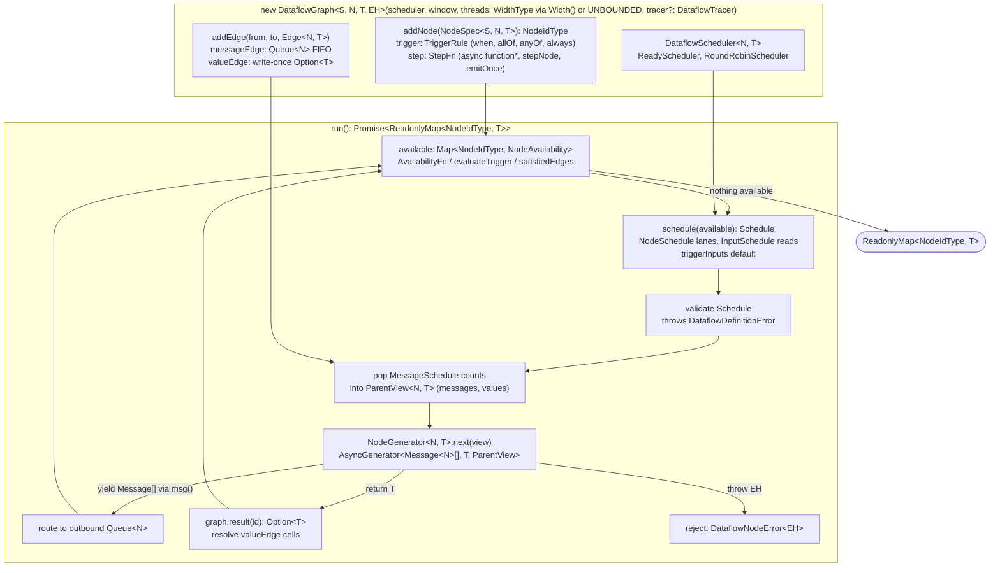

# dataflow-engine

Async-generator dataflow engine for TypeScript with pluggable schedulers.

Each node is an `async function*`. The runtime resumes it with the inputs its trigger asked for, and routes whatever it yields onto its outbound edges. A pluggable scheduler decides which nodes run each turn and how much each one reads.

## Architecture



| Part | Role |
|---|---|
| `DataflowGraph<S, N, T, EH>` | Owns nodes and edges (an `ngraph.graph` multigraph) and drives `run()`. `N` is the message payload type, `T` the node return type, `S` the node state type and `EH` the error type that node bodies throw. |
| `messageEdge` / `valueEdge` | A FIFO queue of `N`, or a write-once cell that holds the source node's return value. |
| Triggers | Decide **which** inbound edges must have something before a node can run: `always`, `when`, `allOf`, `anyOf`, `never`. |
| `DataflowScheduler` | Decides **who** runs, in which lane and turn, and **how much** each node reads from each edge. |

## Install

The package isn't published to npm. Build it and install the tarball:

```sh
bun install && bun run build && bun pm pack     # writes dataflow-engine-0.1.0.tgz
cd ../your-app && bun add ../dataflow-engine/dataflow-engine-0.1.0.tgz
```

Under Bun, the `bun` export condition loads `src/index.ts` directly. The `import` condition serves the Bun-built `dist/index.js`, and types come from `dist/index.d.ts`.

## Quick start

```ts
import {
  DataflowGraph, ReadyScheduler, UNBOUNDED, Width,
  always, emitOnce, from, messageEdge, msg, stepNode, when,
} from "dataflow-engine";
import type { NodeGenerator } from "dataflow-engine";

const numbers = messageEdge<number, string>("numbers");
const squares = messageEdge<number, string>("squares");
const graph = new DataflowGraph<void, number, string, never>(
  new ReadyScheduler(), Width(1), UNBOUNDED,
);

const source = graph.addNode({
  state: undefined,
  trigger: always(),
  step: emitOnce(() => [msg(numbers, 1), msg(numbers, 2), msg(numbers, 3)], "source done"),
});

const square = graph.addNode({
  state: undefined,
  trigger: when(numbers),
  step: async function* (): NodeGenerator<number, string> {
    let view = yield []; // prime: the first activation delivers no input
    while (true) view = yield from(view, numbers).map((n) => msg(squares, n * n));
  },
});

const seen: number[] = [];
const sink = graph.addNode({
  state: undefined,
  trigger: when(squares),
  step: stepNode((_state, view) => {
    seen.push(...from(view, squares));
    return [];
  }),
});

graph.addEdge(source, square, numbers).addEdge(square, sink, squares);
const results = await graph.run();
// seen = [1, 4, 9]; results.get(source) = "source done"; square and sink never return.
```

## Writing nodes as async generators

A node body has the type `NodeGenerator<N, T> = AsyncGenerator<Message<N>[], T, ParentView<N, T>>`. Each activation advances its generator exactly once:

1. **Prime.** On a node's first activation, the runtime calls `step()` and then `next()` without consuming any input. A dependent node therefore starts with `let view = yield []`, while a source can yield real output straight away.
2. **Deliver.** Every later activation pops the scheduled inputs and calls `next(view)`. `from(view, edge)` (or `view.messages.get(edge.id)`) is this turn's batch from that edge. A key exists only for an edge that actually delivered something, which is how an `anyOf` body tells which branch fired. `view.values` holds the value edges that have resolved.
3. **Emit.** Each `yield` is the full list of messages for this turn, routed in order. `yield []` emits nothing and keeps the node alive.
4. **Finish.** `return value` marks the node `done`, records `value` in `run()`'s result map and resolves every outbound value edge. A node that never returns, such as a sink or anything built with `stepNode`, is absent from the results.
5. **Fail.** A throw terminates the node, and `run()` rejects with `DataflowNodeError` (`nodeId`, `error: EH`).

A non-arrow body receives its `Node` as `this`, so it can read and write `this.state`.

Local variables in a generator persist across activations. Here, taken from `examples/fibonacci.ts`, a node feeds itself through a self-loop and stops after ten turns:

```ts
const fib = graph.addNode({
  state: undefined,
  trigger: anyOf(on(seed), on(loop)),
  step: async function* (): NodeGenerator<number, string> {
    let view = yield [];
    for (let i = 0; i < 10; i++) {
      const [a, b] = (view.messages.get(seed.id) ?? view.messages.get(loop.id))!;
      view = yield [msg(out, a), msg(loop, b), msg(loop, a + b)];
    }
    return "emitted 10";
  },
});
graph.addEdge(seedId, fib, seed).addEdge(fib, fib, loop).addEdge(fib, sinkId, out);
```

A value edge passes a node's return value downstream:

```ts
const done = valueEdge<number, string>("done");
const report = graph.addNode({
  state: undefined,
  trigger: when(done),
  step: async function* (): NodeGenerator<number, string> {
    const view = yield [];
    return `source returned: ${view.values.get(done.id)}`;
  },
});
graph.addEdge(source, report, done);
```

A value edge is never consumed: once resolved, it satisfies its trigger on every later turn. A node triggered only by value edges must therefore return, or `run()` never settles.

## Triggers and schedulers

| Trigger | Fires when |
|---|---|
| `always()` | every turn (use for sources) |
| `when(e)` | `e` has a queued message or a resolved value |
| `allOf(on(a), on(b))` | every entry is satisfied; when only some are, nothing is read |
| `anyOf(on(a), on(b))` | the first satisfied entry, in the order given |

A node that must wait for a deeper backlog can supply an `is_available(view)` hook.

| Scheduler | Plan |
|---|---|
| `ReadyScheduler` | Runs every available node in one concurrent turn. Construct the graph with `threads = UNBOUNDED`. |
| `RoundRobinScheduler` | Fills `threads` lanes x `window` turns, rotating so that no node starves. |
| Custom | Implement `create(window, threads)` and `schedule(available)`. |

```ts
class OneAtATime implements DataflowScheduler<number, string> {
  create(_window: number, _threads: number): void {}
  schedule(available: ReadonlyMap<NodeIdType, NodeAvailability<number, string>>): Schedule {
    const [first] = available;
    return first ? [[{ id: first[0], inputs: triggerInputs(first[1]) }]] : [];
  }
}
```

`triggerInputs` reads each fired edge whole. To read fixed-size batches instead, return counts (`n`, `"all"` or `"none"`) per edge. The graph validates every plan against the lane and window limits, availability and read counts, and throws `DataflowDefinitionError` on a violation. Graph wiring mistakes throw the same error.

`run()` resolves once no node is available. It can be resumed: add nodes or edges and call it again. It is not re-entrant.

## Tracing

Pass a `DataflowTracer` as the fourth constructor argument to observe execution; omit it for an untraced graph. `startRun(graph)` is called once per `run()` and returns a handle that sees every generator activation (`"prime"` with no view, `"resume"` with exactly the delivered view), its yield or return, node failures and the run's end or failure. Callbacks are synchronous observers: they must not mutate what they receive, and an exception they throw is reported with `console.warn` and cannot change the computation. `flush()` is caller-owned; the graph never awaits it.

`DummyTracer` is the shipped no-op implementation. The separate [`dataflow-engine-opik`](../dataflow-engine-opik) package provides `OpikDataflowTracer(client, name?)`, which exports each run as one Opik trace carrying the graph's Mermaid topology and one child span per activation. This package never depends on Opik.

## Examples and development

`bun run examples` runs four fixed-input graphs, each printing one JSON line: `fibonacci`, `multiplier` (with a custom priority scheduler), `word-count` (split outputs merged by an `anyOf` fan-in) and `combine-per-key` (fan-out to two reducers). The `tests/*.example.ts` files are larger cookbook graphs.

Every example is traced with Opik by default. The tracer is chosen at **build** time: `examples/run.ts` typechecks and bundles all sixteen programs into `examples/dist/{opik,dummy}` before running any of them. The Opik build constructs the SDK client once as a preflight, so a missing optional dependency, a type error or an invalid Opik configuration fails the build before any example runs. Append `--no-tracing` to select `DummyTracer`; that build never resolves Opik. There is no runtime fallback.

The Opik build needs the private examples package's optional dependencies (`dataflow-engine-opik` from the sibling checkout, and `opik`): run `bun install` in `examples/`, then configure the SDK the usual way (`OPIK_API_KEY`, `OPIK_WORKSPACE`, `OPIK_PROJECT_NAME` or `~/.opik.config`). The example commands export to a local Opik at `http://localhost:8888/api` (start one with `NGINX_PORT=8888 ./opik.sh` from the [Opik repository](https://github.com/comet-ml/opik); the UI is `http://localhost:8888`) unless `OPIK_URL_OVERRIDE` is set; because that default is applied as the environment variable, it also takes precedence over a `url_override` in `~/.opik.config`. `bun install --omit optional` gives a Dummy-only environment. A successful build does not prove that traces were ingested later.

| Script | Purpose |
|---|---|
| `bun run build` | ESM bundle and source map (Bun), plus declarations (`tsc`) |
| `bun run typecheck` | Checks `src`, `tests` and `examples` with the Dummy tracer selected, including the compile-only `Width` cases |
| `bun run test` / `test:coverage` | Tests and cookbook fixtures with the Dummy tracer; the coverage run writes a text report and `coverage/lcov.info` |
| `bun run examples` / `example:<name>` | Build and run the standalone examples (Opik; add `--no-tracing` for Dummy) |
| `bun run examples:cookbook` | Build and run the twelve cookbook fixtures (Opik; add `--no-tracing` for Dummy) |
| `bun run examples:build` | Build only (`--no-tracing` for Dummy) |
| `bun run check` / `format` | Biome lint and format |

### Running Fibonacci with Opik

Prerequisites: Bun, Docker with Compose, and this repository checked out next to [`dataflow-engine-opik`](../dataflow-engine-opik):

```text
git/
├── dataflow-engine/
└── dataflow-engine-opik/
```

1. Build the engine, then the Opik integration, which consumes the engine's build output:

   ```sh
   cd dataflow-engine && bun install && bun run build
   cd ../dataflow-engine-opik && bun install && bun run build
   ```

2. Install the examples' optional dependencies (`dataflow-engine-opik` and `opik`):

   ```sh
   cd ../dataflow-engine/examples && bun install
   ```

3. Start a local Opik with its UI and API on port 8888:

   ```sh
   git clone https://github.com/comet-ml/opik.git ../../opik
   cd ../../opik && NGINX_PORT=8888 ./opik.sh
   ```

4. Run the example from this repository:

   ```sh
   cd ../dataflow-engine
   OPIK_PROJECT_NAME=dataflow-engine bun run example:fibonacci
   ```

   It prints `[0,1,1,2,3,5,8,13,21,34]`. Without `OPIK_PROJECT_NAME` the trace goes to Opik's "Default Project".

5. Open <http://localhost:8888>, choose project **dataflow-engine** → **Logs** → **Traces**, and open the `examples/fibonacci` row. The **Agent graph** panel below the span list shows nodes `0`, `1` and `2`, the `fibSeed` and `fibOut` edges and the `fibLoop` self-loop; each `1 #n` span holds one activation's delivered input and emitted output.

6. Stop Opik when finished: `cd ../opik && ./opik.sh --stop`.

## License

[MIT](LICENSE)
