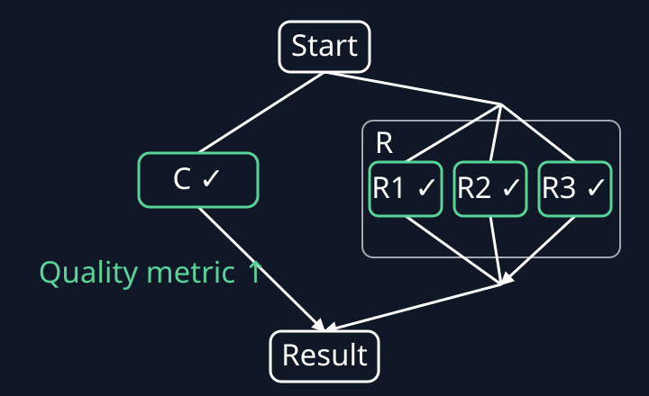
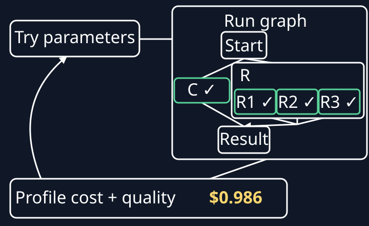
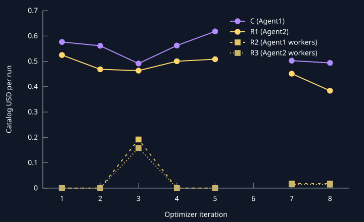
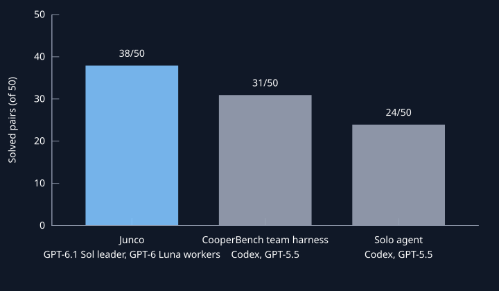
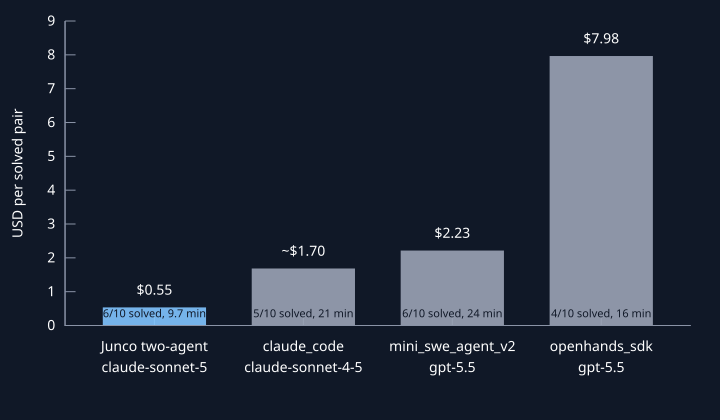
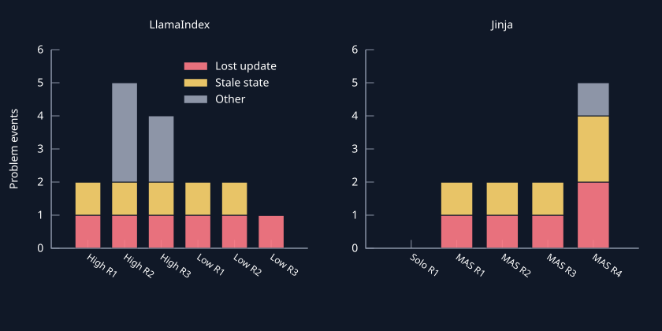
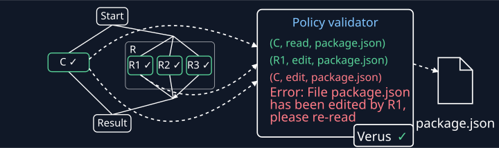
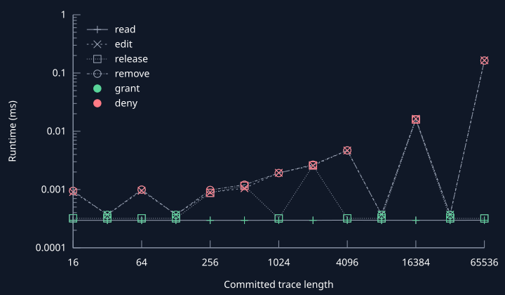
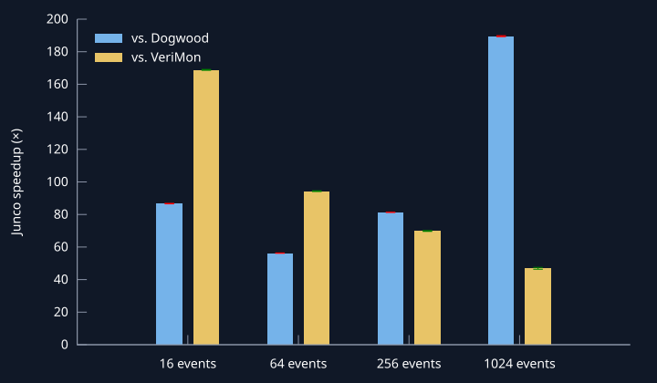
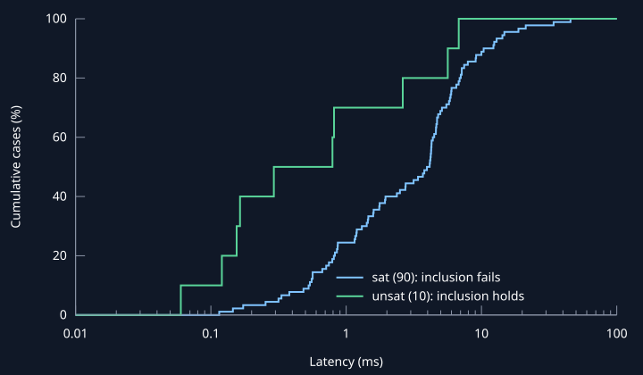

# Junco

Junco is a multi-agent system for policy-validated software engineering at scale. It separates the data dependency graph ("what work must be done") from a learned scheduler ("when and at what cost to do it") and policy ("what not to do"). A multi-agent system that is profiled, analyzed and optimized this way can match or beat other multi-agent frameworks on software engineering benchmarks at a fraction of the cost: on CooperBench, Junco solves 38/50 paired features versus 31/50 for the best existing team harness, and resolves tasks at $0.55 each versus $1.70 to $7.98 for other frameworks.


## How to use

### Prerequisites

Junco runs only on Linux, on Btrfs. Install:

- [Bun](https://bun.com/docs/installation) 1.4.2
- [Pi](https://docs.pi.dev/latest/quickstart), the agent harness Junco drives
- Rust 1.98.1 through [rustup](https://rust-lang.org/tools/install/)
- Clang and libbtrfsutil. On Ubuntu:

```sh
sudo apt-get update
sudo apt-get install --no-install-recommends \
  build-essential pkg-config clang libclang-dev llvm-dev \
  libbtrfsutil-dev zlib1g-dev ca-certificates curl git
```

### Prerequisites for observability

Opik and Grafana run in Docker containers started by Docker Compose from [`docker-compose.yml`](docker-compose.yml). On Ubuntu, install Docker Engine and the Compose plugin from [Docker's apt repository](https://docs.docker.com/engine/install/ubuntu/). Remove Ubuntu's `docker.io`, `docker-compose` and `docker-compose-v2` packages first if they are installed.

```sh
sudo install -m 0755 -d /etc/apt/keyrings
sudo curl -fsSL https://download.docker.com/linux/ubuntu/gpg -o /etc/apt/keyrings/docker.asc
sudo chmod a+r /etc/apt/keyrings/docker.asc
sudo tee /etc/apt/sources.list.d/docker.sources <<EOF
Types: deb
URIs: https://download.docker.com/linux/ubuntu
Suites: $(. /etc/os-release && echo "${UBUNTU_CODENAME:-$VERSION_CODENAME}")
Components: stable
Architectures: $(dpkg --print-architecture)
Signed-By: /etc/apt/keyrings/docker.asc
EOF
sudo apt-get update
sudo apt-get install docker-ce docker-ce-cli containerd.io docker-buildx-plugin docker-compose-plugin
sudo usermod -aG docker "$USER"   # log out and back in to run docker without sudo
docker compose version
```

The Compose file includes Opik's own deployment from a checkout beside this one:

```sh
git clone https://github.com/comet-ml/opik.git ../opik
```

### Install

```sh
bun install --frozen-lockfile  # also builds the native addon
bun run install                # interactive: global CLIs plus the skills for the harnesses you pick
```

`bun run install` installs the `junco-profile-optimizer` CLI and copies the three skills into the harnesses you pick: GitHub Copilot CLI, Claude Code, Pi, OpenAI Codex or OpenCode.

### Set up a Btrfs subvolume

Marsh stages concurrent file access to prevent races, so Junco needs a Btrfs copy-on-write file system: either an existing Btrfs subvolume or a new loopback image. Agents work in a dedicated subvolume, the seed. Junco finds the seed that encloses the working directory and never creates one.

#### Existing Btrfs subvolume

The mount needs the option `user_subvol_rm_allowed`; Marsh refuses to run without it. Add the option to the mount's `/etc/fstab` entry to keep it after a reboot.

```sh
findmnt -T "$HOME/work" -o TARGET,FSTYPE,OPTIONS             # expect btrfs
sudo mount -o remount,user_subvol_rm_allowed /mount/target   # TARGET from findmnt
btrfs subvolume create "$HOME/work/seed"                     # clone your repository inside it
```

#### New Btrfs loopback

```sh
truncate -s 32G junco.img && mkfs.btrfs -q junco.img
sudo mount -o loop,user_subvol_rm_allowed,compress=zstd:1 junco.img /mnt/junco
sudo btrfs subvolume create /mnt/junco/seed && sudo chown "$USER" /mnt/junco/seed
```

### My first Junco workflow

A workflow has two files. `name.yml` declares the nodes, edges and triggers. `name.ts` builds it with `JuncoGraph.fromYaml(source, { cwd, scheduler, ladder, ... })`, awaits `execution.run()` and closes the graph; `cwd` selects the seed. In [`examples/first`](examples/first), two agents answer one question by browsing with the Playwright MCP server, and a reviewer merges their answers:

```yaml
graph:
  name: First
  nodes:
    Goals:
      kind: emit
      text: What are the current stable versions of Bun and of Rust, and when were they released? Cite the page you read each answer from.
      spec: Both versions and release dates are stated, each with a cited source page.
    Bun:
      prompt: Answer the question in the user message(s) following this prompt for Bun only, browsing from https://bun.sh with the playwright tools.
    Rust:
      prompt: Answer the question in the user message(s) following this prompt for Rust only, browsing from https://www.rust-lang.org with the playwright tools.
    Reviewer:
      prompt: |-
        Merge the two answers below into one table of tool, version, release date and source URL. Keep a claim only if it cites a page.

        Bun:
        {{Bun->Reviewer}}

        Rust:
        {{Rust->Reviewer}}
  edges:
    - {from: Goals, to: Bun, kind: message, schema: {}}
    - {from: Goals, to: Rust, kind: message, schema: {}}
    - {from: Bun, to: Reviewer, id: Bun->Reviewer, kind: message, on: return, schema: {}}
    - {from: Rust, to: Reviewer, id: Rust->Reviewer, kind: message, on: return, schema: {}}
    - {from: Reviewer, to: $sink, schema: {}}
```

`Goals` sends the question once to each browser agent. `first.ts` maps a separate Playwright collection to each browser agent; `Reviewer` inherits the native default and gets neither browser. When both browser agents return, the reviewer consumes their reports through `{{Bun->Reviewer}}` and `{{Rust->Reviewer}}`.

`fromYaml` constructs and owns each agent. A YAML `prompt` supplies its reusable instruction; a promptless agent can instead receive input or have an instruction staged by a controller. `always` and resolved value cells remain true: driving an agent with either can make unbounded model calls. For a finite run, send a one-shot assignment from `kind: emit`, or trigger on a consumable `kind: message, on: return` edge as above. Reaching `$sink` does not stop other runnable nodes. `step()` advances one scheduling decision.

Set `repeat` on a YAML node to cap its work over the graph's lifetime. For example, `A: {prompt: Generate a unit test, trigger: always, repeat: 3}` runs the prompt at most three times **in total**, across all `step()` and `run()` calls. `repeat: 0` disables the node; omitting it leaves the node uncapped. A cap does not make a one-shot node run again, and it does not interrupt a prompt to limit its model turns.

The scheduler decides which queued messages a node reads: each `NodeModel` it selects lists those edges in `readEdges`. `schedules.select(snapshot, ids, strength?)` reads the edges from `schedules.plannedReads(snapshot, id)` by default, and `schedules.reads(assign, inner)` overrides them. `schedules.reads(() => [], schedules.parallel())` runs nodes without consuming any message. If a decision is invalid, the scheduler is asked again with `snapshot.lastError`, up to three attempts in all, and then the run throws.

An ordinary selected message reaches the agent as a separate user message in delivery order. `Task` text and images arrive as message content with a `Task:` JSON line (`taskId`, `spec`, `deps`, `history`); other payloads arrive as `JSON.stringify({ id, payload })`. A `{{edge}}` placeholder can read a retained value or render the products consumed from an `on: return` FIFO, joined with a blank line. Products rendered in the prompt are not also steered. Ordinary message edges cannot be interpolated.

Every workflow containing agents needs a model ladder and a native-backed tool collection for each role. `tools` maps qualified agent IDs to collections, not tool names to functions. An omitted role uses `collection` or, if none was supplied, one native default shared by all unmapped agents. Use `tool_block` in YAML for exact-name exclusions; blocking all tools does not skip collection acquisition. A workflow with no agents needs neither a ladder nor a native seed.

```ts
import { ModelRuntime } from "@earendil-works/pi-coding-agent";
import { graph, JuncoGraph, mcp, schedules, syntax, type tools, tracer } from "junco";
import source from "./first.yml" with { type: "text" };

const models = await ModelRuntime.create();
const ladder = new schedules.ModelLadder(models, schedules.uniformLadder({ model: "github-copilot/claude-sonnet-5.5", thinking: "medium" }));
const playwright = { name: "playwright", type: "stdio", command: "npx", args: ["-y", "@playwright/mcp@latest", "--headless"] } as const;
/** One Playwright server, and so one browser, per browsing agent: its own collection. */
const browsers = new Map<graph.NodeIdType, tools.ToolCollection>();
const observer = tracer.TuiTracer.shared();
let answer: string;
try {
  await using collections = new AsyncDisposableStack();
  for (const node of ["Bun", "Rust"]) {
    const browser = await new mcp.McpBuilder().add(playwright).build(process.cwd());
    browsers.set(graph.NodeId.create(node), collections.adopt(browser, (c) => c.close()));
  }
  const execution = await JuncoGraph.fromYaml(source, {
    cwd: process.cwd(),
    scheduler: () => schedules.parallel(),
    ladder,
    tools: browsers,
    tracer: observer,
  });
  try {
    const results = await execution.run();
    answer = syntax.finalText(results.get(graph.NodeId.create("Reviewer")), "Reviewer");
  } finally {
    await execution.graph.close();
  }
} finally {
  if (observer instanceof tracer.TuiTracer) await observer.finish();
}
console.log(answer);
```

For a nested agent, use `graph.NodeId.create("Child/Worker")`; escape a literal `~` or `/` in each ID segment as `~0` or `~1`. The same keys select `agentOptions` (for example, a distinct session or an error handler per role). Supplied sessions transfer to the builder even on failure; supplied collections remain yours to close after the graph. For a custom tool, create a collection with `ToolCollection.create(cwd, { policy, extend })` and map it only to authorized agents. See the [authoring reference](skills/junco-graph-create/SKILL.md#runner) for allowed options.

```sh
pi                                                      # once: `/login`, pick GitHub Copilot, quit
cd "$HOME/work/seed" && bun run /path/to/junco/examples/first/first.ts
```

### Junco Monitor

The [web monitor](packages/junco-frontend/) shows Graph and Tool calls above a full-width Tasks board. Row labels show the last eight characters of the task ID; hover a label to see the full ID. Click a card or graph node, or focus it and press Enter or Space, to open its live details without moving the board. Escape closes the details and returns focus to the trigger.

The Graph panel fits the whole diagram below the run label. It chooses left-to-right or top-to-bottom, whichever makes the labels larger in the available space, and updates that choice when the panel resizes.

### The three skills

Installed skills answer plain requests; no slash command.

| Skill | Ask your harness to | What happens |
| --- | --- | --- |
| `junco-graph-create` | build "a multi-agent workflow", "fan-out/fan-in", "a Ralph loop", "committee rounds", "an agent pipeline" | Writes a runnable `name.yml` + `name.ts` pair from the standard workflows and schedulers in the [standard library](https://github.com/microsoft/junco/wiki/Standard-Library). |
| `junco-graph-optimizer` | "restructure", "decompose", "add a tournament to" or "prune" an existing graph | Rewrites the YAML topology from measured runs; models, scheduler and limits stay. |
| `junco-profile-optimizer` | "profile", "tune", "cheapen", "speed up" or "shrink" a workflow, "compare schedulers or model ladders" | Hill climbing over the unbounded space of models, thinking levels, scheduler configurations and limits (memory, CPU, tool calls), measuring each step, until the objective (USD, tokens, memory or a probe) converges while quality thresholds hold. |

<p>



</p>

On the CooperBench pair the profile optimizer searched schedulers, model ladders and tool caps. GPT-6.1 Sol leading GPT-6 Luna workers cut the mean cost per run from $1.101 to $0.986 while resolving 5 of 5 pairs instead of 2 to 3.

## Results

### CooperBench

<p>



</p>

Two agents implement one pair of features on a shared checkout and succeed when both hidden suites pass on one merged tree. Junco's shared-worktree graph solved 38/50 in each of two independent runs; on CooperBench core the two-agent graph on claude-sonnet-5 spent $3.31 in total.

The problem events CooperBench records are lost updates and stale state, the two classes the ownership policy rejects. Recovering from one costs about 240K model tokens, about $4.7K across all of CooperBench.

### The policy validator



Every tool call is an event (agent, action, resource) checked against the policy and the history before it runs. The policy evaluation and history core is verified with Verus, and the engine is being integrated into Regorus, Azure's policy tool.

#### Checking is fast and policies are analyzable

<p>



</p>

Warm decisions: about 0.3 µs per read, under 0.2 ms per edit or remove at 65,536 committed events. Cold replay: 56 to 190 times faster than Dogwood and 47 to 169 times faster than VeriMon.

Policies are trace languages, so the same engine decides whether one policy subsumes another ($P \subseteq P'$), whether a policy accepts no trace or every trace ($P \subseteq \bot$, $\top \subseteq P$), and whether known good traces are allowed ($\{t_i\} \subseteq P$). The CDF covers the 100 RegExLib inclusion problems of the SMT-LIB regex benchmark.

## Further reading

- [`packages/dataflow-engine`](packages/dataflow-engine/README.md), [`packages/junco-tools`](packages/junco-tools/README.md), [`crates/marsh`](crates/marsh/README.md), [`crates/junco-policy`](crates/junco-policy/README.md).
- [`examples/`](examples): recursive agency, mixed, OSS committee, CaMeL, MCP, Verus loop, Yak shaver, CooperBench and SWE-bench.
- [Standard library wiki page](https://github.com/microsoft/junco/wiki/Standard-Library).
