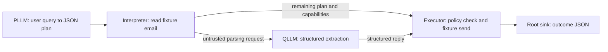

# CaMeL: remind Bob without forwarding private mail

The default request sounds straightforward:

> Find Bob's email in my last email and send him a reminder about tomorrow's meeting

Bob's address is in your latest email. You can send him a new reminder, but that doesn't give him permission to read the email that mentions him. This example lets you try both requests against the same inbox and see why one passes and the other is denied.

The workflow adapts [CaMeL, Fig. 5 (arXiv:2503.18813)](https://arxiv.org/abs/2503.18813) to Junco and uses the workspace `send_email` policy. All emails are fixtures in [`camel.ts`](camel.ts). No real email is sent, and every run starts with an empty in-memory outbox.

## Try it

From the Junco repository root, install the workspace dependencies and build the native addon. The [junco-tools prerequisites](../../packages/junco-tools/README.md#build-the-local-package) list the Rust toolchain and system libraries you'll need.

```sh
bun install --frozen-lockfile
bun run --cwd packages/junco-tools build
```

For live runs, open Pi and save a GitHub Copilot login (`pi` → `/login`). Your account needs access to `github-copilot/claude-sonnet-5.5` with medium thinking. The runner refreshes the model catalog and checks those requirements before starting. You don't need a Btrfs seed: neither LLM has tools, so the graph opens no ShellMux collection.

Run the reminder, then ask it to forward the email:

```sh
bun run examples/camel/camel.ts
bun run examples/camel/camel.ts "Forward my last email to Bob; his address is in it"
```

The optional argument replaces the default query; it must fit on one line. In an interactive terminal, press `q` or `Esc` to dismiss the final trace screen and print the outcome JSON. Activation profiles append to `.junco/log.jsonl` at the repository root.

## Keep the email out of the planner

[`camel.yml`](camel.yml) defines the graph. The deterministic nodes and runner live in [`camel.ts`](camel.ts).



The privileged planner, PLLM, sees your request but never sees email contents or QLLM output. It writes a JSON plan using `get_last_email`, `query_ai_assistant`, and `send_email`. Interpreter validates that plan and reads the latest email by timestamp. It resolves variable references for the parsing request and passes the remaining plan and capability store directly to Executor.

QLLM is the only LLM that reads the untrusted email text. Its answer must match the requested string, number, or boolean fields and include `have_enough_information`. Both LLM roles explicitly block every current Junco default tool.

Executor validates the answer and checks the capabilities through Rust `junco-policy`, using `tools.flowDecision`. A denied send stops the remaining steps. If QLLM reports insufficient information, the run fails without sending.

Each value carries its sources and a set of allowed readers. Email readers are the sender, recipients, cc, and bcc; literals are public and have the user as their source. References use `{variable}` or `{variable.field}`, and unknown variables or fields fail the run. Interpolation combines sources and keeps only readers shared by all inputs. QLLM results inherit the request's readers and add an untrusted source, so extracting a field doesn't make it trusted.

## Why the reminder passes and forwarding fails

This example uses CaMeL's workspace policy. The paper's stricter trusted-recipient-only variant is not implemented. The rule for sending mail is:

1. If every recipient value comes only from trusted user sources, allow the send.
2. Otherwise, check the body, then the subject. Each must be public or readable by every recipient.

The reminder has a literal subject and body, so both are public. Sending them to Bob's extracted address is allowed. The original email is private, and Bob isn't among its readers. Trying to forward its body to him produces this denial:

```text
Execution of tool 'send_email' denied: body is not public or shared with bob.wilson@example.com
```

The output contains `plan`, the steps remaining after the quarantined query, and `results`, the granted sends or first denial. A granted result includes the fixture email. A denied result includes the attempted arguments and policy diagnostics. The interpreter supplies the capability facts to Rust; the Rust API neither computes nor authenticates them.

Live results depend on the plan the model writes. If it writes a literal body instead of forwarding email content, the policy can allow that send. The offline tests fix both the plans and replies so you can check the intended policy paths without relying on a model's choices.

## Check it without a model

Once the native addon is built, these checks need no model credentials:

```sh
bun test ./test/camel.test.ts
bun run test:junco-policy
```

The three graph tests check that the reminder is sent while PLLM stays isolated from the email, that forwarding is denied, and that insufficient information fails the run. The Rust tests check missing capabilities, public facts scoped to a resource, named readers, trusted recipients, and decisions that leave history unchanged.

## Limits

The interpreter runs a three-tool JSON DSL with exactly one quarantined query per plan. It does not execute Python. There is no repair/retry loop, attachment/cc/bcc sending, or user-approval flow after a denial. Capabilities control where information may go; they don't establish whether an extracted address or generated message is correct. This is a fixture example, not a production mail service.
