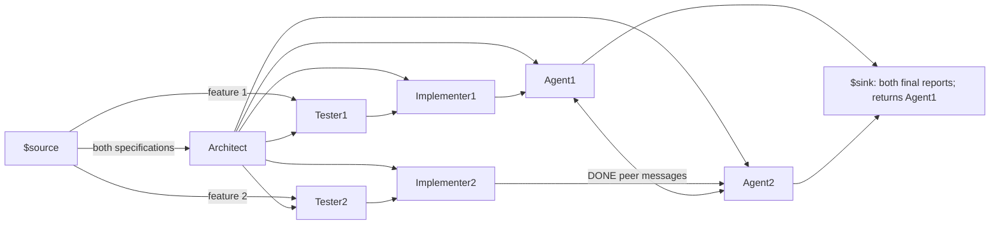

# CooperBench shared-worktree pair

`wf.ts` and `wf.yml` are the canonical CooperBench workflow. The CooperBench launcher builds these exact files into a GNU or musl runtime and runs Junco, model clients, and seven agent roles inside one task container per feature pair.



The read-only Architect receives both specifications and plans interfaces, ownership, and shared-file handoffs. Each feature team receives only its own assignment: Tester writes new acceptance tests, Implementer implements the feature, and Agent reviews independently and integrates with its peer. The two teams share a worktree and run concurrently after planning. Routing is not a confidentiality boundary: agents share a process, worktree, container, and accessible logs. All seven roles block native `task` delegation.

## Models and ownership

All seven roles use `models.worker` on the uniform med rung under `schedules.parallel()`. The request still accepts `models.leader` for the unchanged high/xhigh ladder rungs, but the canonical scheduler does not select them. The launcher defaults both model fields to `github-copilot/gpt-6-luna`, with `--thinking medium`. `off` omits rung thinking; every other level must be supported by both models. There is no model fallback.

All agents share one caller-owned collection with `sandbox: "always"` and `tools.LockPolicy`. The Architect has read/search/managed-shell tools; feature teams also have editing, diff, and release tools. Native messaging remains enabled, but delegation is blocked. Owners must explicitly `release({file})` before handing off edited paths, including ignored/generated caches. A failed agent that does not release leaves its paths owned for the rest of the pair; other agents may read but cannot edit, remove, or release them. The harness neither force-releases nor rolls back that state.

Marsh authorizes command/file-tool publication, not arbitrary OS or network effects. Agents can access copied credentials, outbound networking, and container paths outside the managed worktree.

## Running

From the CooperBench checkout:

```sh
uv run python scripts/run_junco.py --name junco-container-preflight --subset all --junco-dir ../junco --btrfs-root /btrfs --thinking medium --preflight
```

The full denominator is 652 pairs across 30 task images and 12 repositories. Preflight verifies each original base/runner, immutable overlay layers, packaged source hashes, the matching GNU/musl addon, real Btrfs ownership and repeated ignored-cache writes, saved model credentials/common thinking, and telemetry. It generates no paid model completions. CooperBench's README gives the single-pair smoke, full-run, and identical-configuration resume commands.

Host requirements: Linux amd64, a local Docker daemon with BuildKit/buildx, writable Btrfs with `user_subvol_rm_allowed`, the task images, the canonical Junco checkout, saved Pi credentials, and the existing telemetry stack. Host Bun, linked consumer packages, privileged containers, extra capabilities, and Docker-socket mounts are not generation prerequisites. The builder pins Bun 1.4.2, Node 22.19.0, Rust 1.98.1, and its GNU/musl base images.

GNU builds libbtrfsutil 6.12 on Bullseye: its packaged 5.10 library requests an asynchronous snapshot operation removed by current kernels. The musl build applies the pinned btrfsutil 0.2.0 typed-zero correction. Marsh's filesystem-magic and Linux ptrace UAPI types are libc-portable. Neither task libc nor the generated addon loader is replaced.

## Driver protocol

The packaged entry is `/opt/junco-runtime/bin/bun run /opt/junco-runtime/app/examples/cooperbench/wf.ts`. It reads one JSON request from stdin, writes JSONL to stdout, and sends diagnostics to stderr:

```json
{"mode":"run","run_id":"0123456789abcdef0123456789abcdef",
 "models":{"worker":"github-copilot/gpt-6-luna","leader":"github-copilot/gpt-6-luna"},
 "thinking":"medium","timeout_ms":7200000,"problem_dir":"/artifacts",
 "agents":{"agent1":{"feature_id":1,"task":"Implement the first feature."},
           "agent2":{"feature_id":2,"task":"Implement the second feature."}}}
```

Unknown fields, obsolete image/container fields, role-specific thinking objects, nonpositive/noninteger deadlines, equal feature IDs, and blank assignments are rejected. Worktree deployment is fixed at `/workspace/repo`; fixtures supply their collection/cwd through `createPair`, not another request path.

Every role emits native `message` and committed `usage` rows under its team's `agent_id` and root-relative `node_id`; the Architect belongs to `agent1`. One terminal `result` follows graph/agent/collection shutdown and Opik/profile/raw/Grafana flush, with team outcomes, `worker_count` (acquired child attempts, normally zero with delegation blocked), and `agent_count` (built graph agents plus acquired children). `Submitted` requires both normal, nonempty integrator reports and no run or close error. Any native descendants must finish or be cancelled before shutdown. The generation deadline is 7,200 seconds; the launcher backstop is 7,260 seconds. INT gets a 30-second grace before KILL.

`{"mode":"preflight","models":{...},"thinking":"medium"}` returns one `ready` record only after all gates pass, including a private Docker cgroup v2 namespace with readable kernel `memory.peak`. Ready metadata records only stable memory support, never varying byte values. `probeRuntime(worktree)` uses the fresh probe subvolume and production options. `--recover-workspace` forces a real managed `/bin/true` before harvest because opening a collection alone does not replay its lazy durable session.

## Credentials, telemetry, and artifacts

The host streams only selected provider entries from Pi `auth.json` and optional `models-store.json`, plus optional unchanged JSONC `models.json`, into the stopped container's `/run/junco/pi-agent`. No settings, sessions, extensions, host home, or auth-directory bind is provided; refreshes are never copied back. Custom model definitions can themselves contain sensitive provider configuration.

The default bridge is `junco-telemetry_default`. Container ingestion uses `GRAFANA_CONTAINER_URL=http://grafana-proxy` and `OPIK_CONTAINER_URL=http://frontend:5173/api`; only explicitly configured Opik key/workspace/project fields are forwarded. Host-facing `GRAFANA_URL` defaults to `http://localhost:8000`. The launcher rewrites only display-link metadata to that public base; raw recorder files and ingestion stay unchanged. Missing services or credentials fail preflight.

Grafana uses dashboard UID/title `junco-cooperbench` (`/d/junco-cooperbench` on the public Grafana base). Its saved overview defaults to **All** sessions over 15 days; new sessions do not replace that selection. Open the recorded session URL or add `?var-stream=<streamId>` for one pair, then narrow the range before expanding the collapsed detail row. Totals sum each session's last recorded cumulative tokens/cost in the range, not usage earned only during it. Session count includes real zero-usage preflight and health checks with total-token samples. See the root [telemetry documentation](../../README.md#telemetry-deployment) for retention and offline JSONL reconstruction; lost Grafana Live samples are not recovered exactly. Partial histories keep their valid prefix, and missing measurements stay **Not recorded**.

One outer Opik pair-graph trace is retained. `/artifacts/.junco/` holds usage-mode `log.jsonl`, raw `profile_events.jsonl`, `operations.json`, sink-completeness `telemetry.json`, and `memory.json`; failed/cancelled usage and adjustments remain accounted once. Profile paths identify each graph role; any native descendants extend their parent's path with `::task-...` recursively. Canonical execution does not forge optimizer `completion.json`: only optimizer-prepared workflows emit nonce-bound completion after clean shutdown.

A trusted, caller-owned sampler reads the private container root's kernel cgroup v2 `memory.peak` once per second and once after graph/agents/collection/Opik shutdown, before recorder close. This peak includes Bun, all native task/tool descendants, and charged page cache, including allocations already freed. It is a whole-container high-water mark, **not attributable to agents**, and cannot be summed with pipeline peaks. Root metrics use `resource=memory`, `category=benchmark`, `operation=container_memory`, gauge `peak_memory_bytes`; Grafana exports `junco_operation_peak_memory_bytes` at `node="::"`. The dashboard prefers this authoritative series per session, falling back to existing pipeline measurements only when absent. `memory.json` retains version/run ID, `scope=container`, `source=cgroup_v2`, peak bytes or null, completeness, and errors; the host exports it under `result.telemetry.memory`. Missing/invalid/reset readings remain incomplete, never RSS/current-memory substitutes or fabricated zero. New attempts require complete memory telemetry; historical absent sidecars remain unavailable. Per-agent CPU/PID/hardware measurements remain unavailable, not zero; the shared collection still has no recorder/resource-monitor option, delegated cgroup monitor, extra privileges, or resource-ceiling changes.

The launcher records exact container IDs/names and private-parent identity in `resources.json`. After PID 1 stops, a fresh helper replays native recovery before extracting one shared patch for both feature artifacts. Official evaluation uses the original pinned image and its identical-patch path. Cleanup removes only recorded containers and identity-checked descendant subvolumes; incomplete attempts/resources refuse resume. Run-artifact `.junco/` directories are intentional, not source mirrors.

## Tests

From Junco:

```sh
bun run --cwd packages/junco-tools build:native:test
bun test test/cooperbench.test.ts
bun test packages/junco-agent/test/task.test.ts test/task.test.ts
JUNCO_BTRFS_TEST_ROOT=/btrfs bun run --cwd packages/junco-tools test:btrfs
```

The unconditional workflow tests use real Junco agents, faux models, and the CopyTree native test addon; a missing addon fails. Routing checks cover both-spec Architect visibility, team-only assignment prompts, peer messaging, seven-node ownership/accounting, uniform worker models, and blocked delegation. Descendant lifecycle/accounting fixtures explicitly unblock `task` only in their test agents. Structural verdict checkers are dormant helpers for future graph campaigns; they check self-reported evidence, not actual test success. Actual Btrfs publication is checked separately by production preflight in every task overlay. CooperBench's Docker-enabled runner tests exercise PID-1 stopping, shared harvest/recovery, credential isolation, exact-resource cleanup, and refusal paths without live model completions. A no-model Docker memory fixture allocates and frees a native child's memory and checks that final-close root metrics and the durable scoped sidecar retain its kernel peak.
