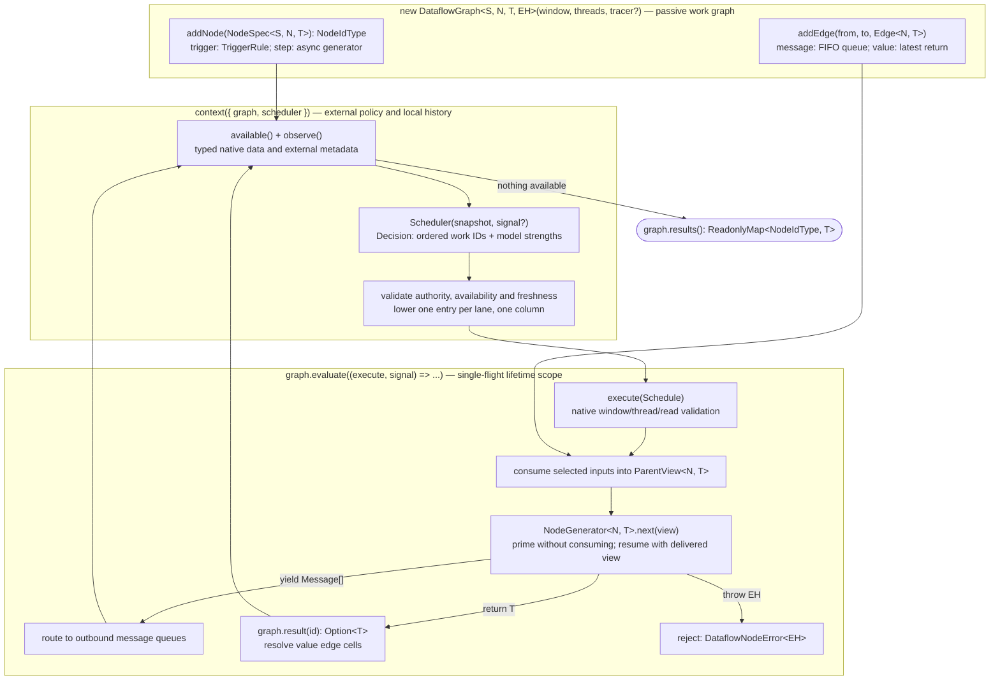

# dataflow-engine

Async-generator dataflow engine for TypeScript with externally paired scheduling policies.

Each node is an `async function*`. The graph owns work, topology, concrete execution and resource lifetime, never a scheduler. The external `junco-scheduler` context selects existing work nodes and lowers each decision to one native column; triggers and pure input-read hooks determine how much each selected node reads.

## Architecture



| Part | Role |
|---|---|
| `DataflowGraph<S, N, T, EH>` | Owns native nodes/edges (an `ngraph.graph` multigraph), observations and concrete execution via `evaluate`. `S` and `T` retain native state and result types; `N extends TSchema` is the TypeBox message schema (payloads are raw `Static<N>`, use a union of schema types for heterogeneous graphs); `EH` is the node-body error type. Construction takes only window/thread bounds and an optional tracer. |
| `Edge.message(id, schema, probe?)` / `Edge.value(id, schema, probe?)` | A FIFO queue of `Static<N>`, or a cell holding the source node's latest return value. The TypeBox schema is required; every emission (and `Source.enqueue`/`Sink.send` against the port `schema`) and every return published on a value edge is validated, failing with `DataflowDefinitionError` before anything is queued or published. The optional `probe(value)` observes each accepted publication once, after it is queued or the cell is updated (a return rejected by any outbound value edge publishes and probes nothing); its exceptions are reported and swallowed. |
| Triggers | Decide **which** inbound edges must have something before a node can run: `always`, `when`, `allOf`, `anyOf`, `never`. |
| `SchedulerContext<S,N,T,C,G>` | Externally pairs a graph with a typed policy, application metadata `C` and independent history; its `step()`/`run()` drive the graph. Policies and contexts are never work members. |

## Install

The package isn't published to npm. It lives in the [junco](https://github.com/microsoft/junco) Bun workspace at `packages/dataflow-engine`. Build it and install the tarball:

```sh
bun install                                                  # once, at the workspace root
(cd packages/dataflow-engine && bun run build && bun pm pack)   # writes dataflow-engine-0.1.0.tgz
cd <your-app> && bun add <junco>/packages/dataflow-engine/dataflow-engine-0.1.0.tgz
```

Under Bun, the `bun` export condition loads `src/index.ts` directly. The `import` condition serves the Bun-built `dist/index.js`, and types come from `dist/index.d.ts`.

## Quick start

```ts
import { context, parallel } from "junco-scheduler";
import {
  DataflowGraph, Edge, EmitOnce, Message, StepNode, TriggerRule, UNBOUNDED, Width, from,
} from "dataflow-engine";
import type { NodeGenerator } from "dataflow-engine";
import { Type } from "typebox";

const NumberSchema = Type.Number();
type Num = typeof NumberSchema;
const numbers = Edge.message<Num, string>("numbers", NumberSchema);
const squares = Edge.message<Num, string>("squares", NumberSchema);
const graph = new DataflowGraph<void, Num, string, never>(
  Width.create(1), UNBOUNDED,
);
const execution = context({ scheduler: parallel(), graph });

const source = graph.addNode(new EmitOnce<void, Num, string>(
  () => [Message.create(numbers, 1), Message.create(numbers, 2), Message.create(numbers, 3)],
  "source done",
  { state: undefined, trigger: TriggerRule.always() },
));

const square = graph.addNode({
  state: undefined,
  trigger: TriggerRule.when(numbers),
  step: async function* (): NodeGenerator<Num, string> {
    let view = yield []; // prime: the first activation delivers no input
    while (true) view = yield from(view, numbers).map((n) => Message.create(squares, n * n));
  },
});

const seen: number[] = [];
const sink = graph.addNode(new StepNode<void, Num, string>((_state, view) => {
  seen.push(...from(view, squares));
  return [];
}, { state: undefined, trigger: TriggerRule.when(squares) }));

graph.addEdge(source, square, numbers).addEdge(square, sink, squares);
const results = await execution.run();
// seen = [1, 4, 9]; results.get(source) = "source done"; square and sink never return.
```

## Writing nodes as async generators

A node body has the type `NodeGenerator<N, T> = AsyncGenerator<Message<N>[], T, ParentView<N, T>>`. Each activation advances its generator exactly once:

1. **Prime.** On a node's first activation (or its first activation after re-arming), the runtime calls `step()` to create a fresh generator and then `next()` without consuming any input. A dependent node therefore starts with `let view = yield []`, while a source can yield real output straight away.
2. **Deliver.** Every later activation pops the scheduled inputs and calls `next(view)`. `from(view, edge)` (or `view.messages.get(edge.id)`) is this turn's batch from that edge. A key exists only for an edge that actually delivered something, which is how an `anyOf` body tells which branch fired. `view.values` holds the value edges that have resolved.
3. **Emit.** Each `yield` is the full list of messages for this turn, routed in order. `yield []` emits nothing and keeps the node alive.
4. **Finish.** `return value` marks the node `done`, replaces its retained value in `graph.results()` and the context drive's result map, and re-resolves every outbound value edge with that latest return. A value edge from the node to itself immediately re-arms it to `ready`, discarding the finished generator but retaining the same node state. Its next activation starts a new generator. A node that never returns, such as a streaming sink or any `StepNode`, is absent from the results.
5. **Fail.** A throw terminates the node and rejects execution with `DataflowNodeError` (`nodeId`, `error: EH`) — unless the node has an `on_error` hook (below). A `UsageLimitError` (an exhausted token or tool budget; see `junco-scheduler`'s `limit`), alone or inside an `AggregateError`/`cause` chain, propagates unchanged and never reaches `on_error`. A budget that already failed refuses the activation before it starts, and fails it after its body returns, before anything is routed.

An optional `on_error(error, signal)` (`ErrorFn<S, N, T>`) on the spec recovers a body failure: a throw from `step()` or the generator's `next()`. The node is `done` first; the hook then runs once, as a method with the node as `this`, in the same activation, and its returned messages are routed in order like a yield (`[]` routes nothing). The node records no result and its value edges stay unresolved; the tracer sees the activation's `fail(error)` and, if nothing else fails, a normal run `end`. A body that threw exactly the aborted signal's reason propagates it without calling the hook. Wiring, scheduling and routing errors (`DataflowDefinitionError`) never reach it. A hook that throws rejects the invocation with `DataflowNodeError` carrying its own error (or a `DataflowDefinitionError`/the aborted signal's reason unchanged) and is never run again; an unwired returned message rejects after earlier ones were queued.

A non-arrow body receives its `Node` as `this`, so it can read and write `this.state`.

Local variables in a generator persist across activations, but not across re-armed runs; retain cross-run data in the node's state. Here, taken from `examples/fibonacci.ts`, a node feeds itself through a message self-loop within one generator and stops after ten turns:

```ts
const fib = graph.addNode({
  state: undefined,
  trigger: TriggerRule.anyOf(TriggerEntry.on(seed), TriggerEntry.on(loop)),
  step: async function* (): NodeGenerator<Num, string> {
    let view = yield [];
    for (let i = 0; i < 10; i++) {
      const [a, b] = (view.messages.get(seed.id) ?? view.messages.get(loop.id))!;
      view = yield [Message.create(out, a), Message.create(loop, b), Message.create(loop, a + b)];
    }
    return "emitted 10";
  },
});
graph.addEdge(seedId, fib, seed).addEdge(fib, fib, loop).addEdge(fib, sinkId, out);
```

A value edge passes a node's return value downstream:

```ts
const done = Edge.value("done", Type.String()); // Edge<never, string>
const report = graph.addNode({
  state: undefined,
  trigger: TriggerRule.when(done),
  step: async function* (): NodeGenerator<Num, string> {
    const view = yield [];
    return `source returned: ${view.values.get(done.id)}`;
  },
});
graph.addEdge(source, report, done);
```

A value edge is never consumed: once resolved, it satisfies its trigger on every later turn and carries the source's latest return. Only a **value self-edge** re-arms a returned node: re-resolution on a non-self edge never re-arms a finished consumer, and message self-edges do not re-arm it either. A value-feedback loop must bound its runs with `is_available` (for example, a retained round counter); returning alone no longer stops such a loop. More generally, a node triggered only by resolved value edges must return without self-feedback or eventually decline availability, or `run()` never settles.

### Constant fan-out and fan-in

`new ConstFanout(...)` and `new ConstFanin(...)` construct complete specs for `graph.addNode`; wire their edges with `graph.addEdge` as usual. `new ConstFanout(payload, outputs, { state, ret })` sends the same `payload` (by reference) once on every output message edge, then returns `ret`. `new ConstFanin(inputs, output, { state, ret })` waits until every input message edge has delivered, across any number of activations or `run()` calls, then sends one list on `output` in `inputs` order (not arrival order) and returns `ret`; later input never produces another list, and no inputs send one `[]`. Inputs are `Edge<C, T>` and the output is `Edge<TArray<C>, T>`, so the graph's message type must admit both. Construct one `ConstFanin` per collector node. Both throw `DataflowDefinitionError` for a value edge or a repeated edge id.

```ts
import { context, parallel } from "junco-scheduler";
import { ConstFanout, ConstFanin, DataflowGraph, Edge, StepNode, TriggerRule, UNBOUNDED, Width, from } from "dataflow-engine";
import { Type } from "typebox";

const NumberSchema = Type.Number();
const ListSchema = Type.Array(NumberSchema);
const a = Edge.message<typeof NumberSchema, string>("a", NumberSchema);
const b = Edge.message<typeof NumberSchema, string>("b", NumberSchema);
const list = Edge.message<typeof ListSchema, string>("list", ListSchema);
const graph = new DataflowGraph<void, typeof NumberSchema | typeof ListSchema, string, never>(Width.create(1), UNBOUNDED);
const execution = context({ scheduler: parallel(), graph });
const one = graph.addNode(new ConstFanout(1, [a], { state: undefined, ret: "one" }));
const two = graph.addNode(new ConstFanout(2, [b], { state: undefined, ret: "two" }));
const join = graph.addNode(new ConstFanin([b, a], list, { state: undefined, ret: "join" }));
const seen: number[] = [];
const sink = graph.addNode(new StepNode<void, number | number[], string>((_state, view) => {
  for (const batch of from(view, list)) {
    if (!Array.isArray(batch)) throw new Error("Expected a collected list");
    seen.push(...batch);
  }
  return [];
}, { state: undefined, trigger: TriggerRule.when(list) }));
graph.addEdge(one, join, a).addEdge(two, join, b).addEdge(join, sink, list); // sink receives [2, 1]
await execution.run(); // seen = [2, 1]
```

## Triggers and schedulers

| Trigger | Fires when |
|---|---|
| `TriggerRule.always()` | every turn (use for sources) |
| `TriggerRule.when(e)` | `e` has a queued message or a resolved value |
| `TriggerRule.allOf(TriggerEntry.on(a), TriggerEntry.on(b))` | every entry is satisfied; when only some are, nothing is read |
| `TriggerRule.anyOf(TriggerEntry.on(a), TriggerEntry.on(b))` | the first satisfied entry, in the order given |

The engine evaluates each node's trigger first, then consults its `is_available(view, triggered)` hook. The default hook returns `triggered`; a node may override it, e.g. to wait for a deeper backlog or to keep a started actor resumable.

`NodeSpec<S, N, T>` is `NodeOptions<N, T>` plus `state`, `step` and the optional `on_error`. `NodeOptions` holds the registration fields every node kind shares: optional `id`, optional `description` (free prose, kept on the registered `Node` when given and never used for scheduling), the required `trigger` and the optional `is_available` hook. Libraries building node specs reuse this type rather than declaring their own.

`DataflowGraph<S, N, T, EH, K = never>` optionally declares resource kinds (`"memory"`, `"runtime"`, `"tokens"`). Every node in a profiled graph must supply `profiles: Profiles<K>`; the default keeps existing unprofiled specs unchanged. Each `ProfileData<R>` binds its kind to a physical dimension, chooses a `@buge/ts-units` unit, and predicts `{ value, safe, source, reason? }` in that unit. Information units (`bytes` through `gigabytes`, plus `kibibytes`/`mebibytes`/`gibibytes`) and `tokens` are exported here; time units come from `@buge/ts-units/time`. Profile feature ports must be inbound message-edge IDs; `evaluate()` checks wiring before starting a run. Concrete models, validated JSON persistence, and fitting live in the sibling `dataflow-profile` package.

The sibling package `junco-scheduler` supplies selection operators and resource policies; the engine's `Schedule` is only a concrete execution format.

| Policy | Decision |
|---|---|
| `parallel()` | Selects all available owned work in insertion order, in one linear pass; use unbounded threads when all may run together. |
| `roundRobin(order?, width?)` | Derives a cyclic cursor from context-local projected history; default raw string order is `"1" < "10" < "2"`, default width 1. |
| `choose({ where?, rank, width? })` | Filters available owned IDs, sorts by comparator with raw string-ID ties, and takes the requested width (default 1). |
| `separate(leftOwns, left, right)` | Gives complementary disjoint authority/history to both children, drains both, validates scoped selections and concatenates left then right. |
| `agent(invoke)` | Calls a typed oracle once, then chooses only the first non-empty currently applicable stable-deduplicated wave. |
| `limit({ memory }, scheduler)` | Keeps inner order, skipping nodes whose safe memory estimate would exceed the concurrent column's allowance; throws if none fits. |
| `lowest(kind)` / `highest(kind)` | Comparators for `choose`, ordering safe resource predictions in base units; ties use raw string IDs. |

```ts
import { choose, context } from "junco-scheduler";

const execution = context({ graph, scheduler: choose({ rank: () => 0 }) });
const results = await execution.run(); // ties choose by string ID, not registration order
```

`Scheduler<S,N,T,C>` is one sync/async function type returning `{ selected }`, an ordered array of `{ nodeId, modelStrength }` entries; `select(ids)` defaults strengths to `med` (2), and `nodeIds(selected)` extracts native IDs. All native data and metadata remain typed. `parallel()` and `roundRobin()` are universally callable across graph/data domains. Priority/FIFO ranks, nondeterminism and fallback are ordinary TypeScript callbacks, not extra operators. Optional `pi` is imported from `junco-scheduler/agent`, never required by the core entrypoint.

`triggerInputs` reads each fired edge whole. A context's optional pure `readInputs(id, candidate)` instead returns counts (`n`, `"all"` or `"none"`) per edge, and is reused for live reads of running nodes. Native execution validates bounds, availability and all read maps before starting a column; invalid decisions or reads consume nothing and throw `DataflowDefinitionError`. Wiring mistakes throw the same error.

`messageInputs(candidate)` instead reads every nonempty inbound message queue on activation, independent of trigger edges, and consumes no value edges. This keeps inbox delivery opaque while triggers independently control readiness.

Resource policies use each node's profiles and planned input batch, including priming activations. Only `count` features are supported (`n` is capped by queue length, `"all"` reads the queue, absent/`"none"` reads zero); `bytes`/`tokens` features throw rather than inspecting payloads. Every selected node needs a memory profile for `limit`; every compared node needs the ranked profile. Wrap the outermost scheduler so `separate` branches share one allowance. Memory retained across yields is not tracked: leave headroom. Small-work-first policies can delay larger nodes indefinitely.

A `Schedule` is **lanes × turns**: `schedule[lane][turn]`. Turn `w` runs index `w` of every lane concurrently, and the next turn starts only after all of them settle. So `[[A, A], [B]]` runs A and B together, then A alone. A ready node's first occurrence primes its generator and counts as a turn.

The whole window is validated before it starts. Before each turn, the graph takes a fresh availability snapshot and skips any planned node that has since finished or become unavailable. A skipped node is not advanced, reads nothing and is not replaced. For each kept node that is already running, the optional synchronous, pure `resolveInputs(entry, live)` hook recomputes its reads from that snapshot; without the hook, the planned `inputs` are used unchanged, including deliberate partial reads. Every read map in a turn is validated before any node in that turn advances.

### Driving a graph

Construct `const execution = context({ graph, scheduler: parallel() })`; neither graph construction nor pairing calls the policy or starts work.

| Call | Executes |
|---|---|
| `execution.step(options?)` | At most one current decision, lowered to one column. Quiescence returns results without a policy call. |
| `execution.run(options?)` | Repeated current decisions until `graph.available()` is empty. |
| `graph.evaluate((execute, signal) => operation, options?)` | One native evaluation scope around arbitrary planning and serial concrete `execute(schedule, { resolveInputs?, onColumn? })` calls. |

Context drives return cumulative completed-node results, available separately through `graph.results()` or `graph.result(id)`. Quiescence does not imply every node completed. Add nodes/edges or emit inputs and drive again. The graph has no policy `run`/`step` methods or scheduler property. Different contexts may share a graph and have independent histories, but its single-flight evaluation gate rejects overlap before any competing policy runs.

`options.signal` is checked before planning, before each column and after it drains. Original cancellation wins and starts no later column; admitted activations are always awaited. A scope-bound executor rejects concurrent calls and calls after scope exit. Even forgotten/unawaited concrete execution is drained before the evaluation/tracer settles; distinct operation/execution failures aggregate in that order. Successful earlier work is never rolled back. The synchronous non-throwing `onColumn` observer receives actual started IDs in lane order after each non-empty column drains, including a failed column.

### Typed observations and selection authority

`graph.observe(): DataflowObservation<S,N,T>` captures **all** native nodes, including done/unavailable work, with `id`, `status`, defined `description`, native `state` and a readonly kind-erased `profiles` record; insertion-ordered link tuples retain direction, parallel links and self-loops. It also contains all-node detached `ParentView` input containers, retained results and a monotone native version. Reads never invoke readiness hooks, consume inputs or activate work. Cached containers are reused until a tracked mutation, activation admission or settlement advances that version; direct writes through retained nodes/transports or opaque values are not tracked.

Containers, queue arrays, primitive fields and membership/order are detached. Opaque `S/N/T` identities are borrowed, never deep-cloned or frozen: policies must only read them, and applications needing historical object contents must use immutable data. External `describeNode` metadata is captured freshly per decision, not cached with native observations; omission gives an empty `ReadonlyMap<NodeIdType,never>`, while `0`, `false`, `null` and `""` are valid values. A mutation during planning/read lowering rejects the stale decision before execution, without a retry.

`Snapshot<S,N,T,C>` adds available/owned ID sets, typed external context, local committed `Decision[]` history, the graph's thread bound, and `plans: ReadonlyMap<NodeIdType, InputSchedule>` for the current available nodes. The context computes those read plans before invoking the scheduler and reuses them when lowering the decision; live reads still use the pure read hook. `separate` partitions only exclusive **selection authority** over existing work IDs and projects historical selections to each branch, dropping empty events. Native maps, links, metadata, plans and threads remain shared observations. This CSL contract does not partition JavaScript memory, effects, payloads, queues or external services, and authority safety alone promises neither capacity, progress nor fairness. The frame rule requires owned-local readonly callbacks; it is not a sandbox for arbitrary TypeScript.

### Deterministic source and sink ports

`Source<N,T>(route, { id, description? })` and `Sink<N,T>(body, { id, trigger, is_available?, description? })` are real native node specs (`state === this`), exported by the engine. They consume scheduling capacity and appear in topology, tracing and history. Plain `DataflowGraph` does not require ports; `JuncoGraph` requires fresh positional instances.

`source.enqueue(view)` detaches the native edge-addressed `ParentView` and queues non-empty deliveries FIFO; `peek()` is non-consuming. Empty message keys and present value keys (including `undefined`) survive, opaque payloads remain borrowed, and empty ingress is ignored. Only a scheduled Source invokes its synchronous route, consuming one delivery on its first selected activation with no initial empty yield. Route validation and routing run before selected downstream work starts in that column. Its revision advances on admission/consumption, not reads.

A Sink delegates an ordinary generator, intercepts yielded messages into its ordered outbox and yields `[]` internally. `sink.send(message)` can stage final messages before the body returns its exact native `T`. `drain(deliver)` synchronously removes each message only after delivery succeeds; a failed delivery retains that message and the suffix without replaying successful prefixes. A sink's trigger/availability must keep it dormant when no unhandled input exists; retained value edges must not create a busy loop. Nested agency output is only the designated sink's retained result, including present `undefined`, never an arbitrary member selector.

### Emitting from outside a node body

`graph.emit(fromId, Message.create(edge, payload))` synchronously appends one payload to the message edge wired out of `fromId` in this graph, exactly as a yielded message is routed. It only enqueues: it does not drive the graph, consume inputs, complete or start `fromId`, or resolve a value edge; the next availability and read decision observes the message. Calls and yields append in invocation order, and an enqueued message is never rolled back. An edge not wired out of `fromId` (including an incoming-only edge) and a value edge both throw `DataflowDefinitionError`. Call it on the graph that owns the outgoing edge: a nested graph's own `emit` addresses only its internal edges.

## Profile data and fitting

Use `constantProfile("memory", megabytes(3000))` from `dataflow-engine` for fixed per-activation costs, without fitted records. The quantity must be finite and non-negative (zero is valid), and its dimension must match the resource. Each profile retains the supplied unit and reuses one frozen `{ value, safe, source: "fallback", reason: "constant" }` estimate; input vectors are ignored. Persisted profiles still validate their records and prediction vectors in `dataflow-profile`.

Load user-supplied JSON profiles with `parseProfiles(readFileSync(path, "utf8"))`, then `profilesOf(file, "rerank", ["memory", "runtime"])` from `dataflow-profile`. Requested kinds are required; extra kinds are ignored. Features describe input batches using inbound message-edge IDs and `count`, `bytes` or `tokens` measures. The package supplies profile data and predictions, not a resource-aware scheduling policy.

Fit JSONL samples without a recorder:

```sh
cd packages/dataflow-profile
bun run fit fixtures/samples.jsonl /tmp/profiles.json --pins fixtures/pins.json
bun run schemas
```

Each sample has `node`, `features: { port: { count?, bytes?, tokens? } }`, `resources: { memory?, runtime?, tokens? }`, and `units` with one symbol per reported resource. Memory symbols: `B`, `kB`, `MB`, `GB`, `KiB`, `MiB`, `GiB`; runtime: `ms`, `s`, `min`, `h`; tokens: `tok`. Mixed-unit rows convert into the first row's unit for that node/resource. JSON schemas are shipped in `packages/dataflow-profile/schemas/`.

The deterministic fitter considers constants, single-feature linear/power/table models, and a multi-port count-only linear model. Pins select an exact model/features combination, including mixed measures or derived `sum`/`max` features. Fewer than five samples, R² below 0.7, or features outside the fitted range plus 10% tolerance use fallback safety `max(bound, prediction)`; otherwise safety adds the positive residual 95th percentile. Constants always use their bound. `shape` is reserved metadata, not time-segmented scheduling. Automatic mixed-measure model search and sample recording are deliberately absent.

## Rendering graph topology

`DataflowGraph` implements the exported structural `Pretty` contract. `renderPretty(graph)` renders the current topology as Mermaid without layout wrapping. Nodes receive synthetic `n0`, `n1`, … identifiers in iteration order and keep their escaped node IDs as labels; every parallel edge is retained and labeled with its escaped edge ID plus `message` or `value`. An empty graph renders as `""`, and each call reads the live topology so later `addNode` and `addEdge` changes appear immediately.

A node whose state is itself a `DataflowGraph` renders as a `subgraph` titled with its node ID, holding that child graph's nodes and edges (recursively, with identifiers unique across the whole document); the containing graph's edges attach to the subgraph boundary. Every occurrence of a shared child graph expands separately. A child graph with no nodes holds one `(empty graph)` marker, and a child graph already on the current containment path holds one `(recursive reference)` marker instead of expanding again; markers are presentation-only and have no edges.

## Tracing

Pass a `DataflowTracer` as the third constructor argument to observe execution; omit it for an untraced graph. `startRun(graph)` fires once per native `evaluate` scope (therefore once per context `step()`/`run()` invocation), covering planning as well as work. Its handle observes every generator activation (`"prime"` without a view, `"resume"` with the delivered view), yield/return, node failure and invocation end/failure. A context step's `end` means that decision completed, not that the graph is quiescent. `complain(nodeId, complaint)` is independent of any evaluation; the engine never calls it itself. Callbacks are synchronous readonly observers; exceptions warn and cannot change computation. `flush()` remains caller-owned.

`DummyTracer` is the shipped no-op implementation. The separate [`dataflow-engine-opik`](../dataflow-engine-opik) package provides `OpikTracer(client, name?)`, which exports each run as one Opik trace carrying the graph's Mermaid topology and one child span per activation, and each complaint as its own completed `<name>.complain` trace (node ID and complaint text only). This package never depends on Opik.

## Examples and development

`bun run examples` runs six fixed-input graphs, each printing one JSON line: `fibonacci`, `multiplier` (round-robin), `word-count` (`anyOf` fan-in), `combine-per-key` (two reducers), `memory-limit` (4 GB concurrent allowance) and `token-race` (cheapest predicted racer wins). Run the new programs with `bun run example:memory-limit --no-tracing` and `bun run example:token-race --no-tracing`. The `tests/*.example.ts` files are cookbook graphs.

The memory and token cookbook tests share the side-effect-free `examples/resource-scenarios.ts` runners with the standalone entrypoints. Each invocation creates a fresh graph, returns actual execution observations and borrows an optional caller-owned tracer without flushing it.

Tests and examples take their schedulers from the workspace's [`junco-scheduler`](../junco-scheduler), a `workspace:*` development dependency (also a dependency of `examples/`; `src/` never imports it). Fixed resource costs use the engine's `constantProfile`; fitted-profile integration coverage lives in [`dataflow-profile`](../dataflow-profile). Examples bundle workspace sources and need no build. Typechecks read emitted declarations: after `bun install --frozen-lockfile` at the workspace root, build the engine and scheduler:

```sh
bun run build
(cd ../junco-scheduler && bun run build:core)
```

`build:core` builds only the scheduler's deterministic root, against this engine's emitted declarations, so it needs no agent-side dependencies; CI's `core` job builds it the same way.

The workspace links `dataflow-engine` to this package for every consumer, the scheduler included, so classes such as `DataflowDefinitionError` thrown by the scheduler here are this engine's own; downstream consumers that depend on `dataflow-engine` share one instance.

Every example is traced with Opik by default. The tracer is chosen at **build** time: `examples/run.ts` bundles all standalone and cookbook programs from workspace sources into `examples/dist/{opik,dummy}` and runs nothing unless that bundle succeeds, so a missing source or dependency fails before any example runs. Bundling does not typecheck: `bun run typecheck` checks every example with the Dummy tracer and `bun run examples:typecheck` checks the default Opik route. A traced program constructs the Opik SDK client when it starts, so an invalid Opik configuration fails that program before its graph runs. Append `--no-tracing` to select `DummyTracer`; that build never resolves Opik. There is no runtime fallback.

The Opik build needs the examples workspace's optional dependencies (`dataflow-engine`, `dataflow-engine-opik` and `opik`), which the workspace root install provides; the engine and adapter are bundled from source, so neither needs a build. Configure credentials, workspace and project with `OPIK_API_KEY`, `OPIK_WORKSPACE`, `OPIK_PROJECT_NAME` or `~/.opik.config`. The API defaults to `http://localhost:5173/api`; `OPIK_URL_OVERRIDE` overrides it and takes precedence over a `url_override` in `~/.opik.config`. A successful build does not prove that traces were ingested later.

| Script | Purpose |
|---|---|
| `bun run build` | ESM bundle and source map (Bun), plus declarations (`tsc`) |
| `bun run typecheck` | Checks `src`, `tests` and `examples` with the Dummy tracer selected, including the compile-only `Width` cases |
| `bun run test` / `test:coverage` | Tests and cookbook fixtures with the Dummy tracer; the coverage run writes a text report and `coverage/lcov.info` |
| `bun run examples` / `example:<name>` | Build and run the standalone examples (Opik; add `--no-tracing` for Dummy) |
| `bun run examples:cookbook` | Build and run the cookbook fixtures (Opik; add `--no-tracing` for Dummy) |
| `bun run examples:build` | Bundle only, without typechecking (`--no-tracing` for Dummy) |
| `bun run examples:typecheck` | Checks the examples with the default Opik tracer selected, against the engine, scheduler-core and Opik adapter declarations |
| `bun run check` / `format` | Biome lint and format |

### Running Fibonacci with Opik

Prerequisites: Bun, Docker with Compose, and the junco workspace, which holds this package beside [`dataflow-engine-opik`](../dataflow-engine-opik). Run the commands from the workspace root:

1. Install the workspace, which includes the examples' optional dependencies (`dataflow-engine`, `dataflow-engine-opik` and `opik`); the example bundles the engine and the Opik integration from source, so no package build comes first:

   ```sh
   bun install --frozen-lockfile
   ```

2. Start the workspace's root telemetry deployment (see the [Junco setup](../../README.md#telemetry-deployment)); Opik UI/API is on port 5173:

   ```sh
   docker compose -f docker-compose.yml up -d --no-build
   ```

3. Run the example:

   ```sh
   cd packages/dataflow-engine
   OPIK_PROJECT_NAME=dataflow-engine bun run example:fibonacci
   ```

   It prints `[0,1,1,2,3,5,8,13,21,34]`. Without `OPIK_PROJECT_NAME` the trace goes to Opik's "Default Project".

4. Open <http://localhost:5173>, choose project **dataflow-engine** → **Logs** → **Traces**, and open the `examples/fibonacci` row. The **Agent graph** panel below the span list shows nodes `0`, `1` and `2`, the `fibSeed` and `fibOut` edges and the `fibLoop` self-loop; each `1 #n` span holds one activation's delivered input and emitted output.

5. On a disposable development deployment, stop the stack with `docker compose -f docker-compose.yml stop` from the workspace root. Leave shared services running.

## License

[MIT](LICENSE)
