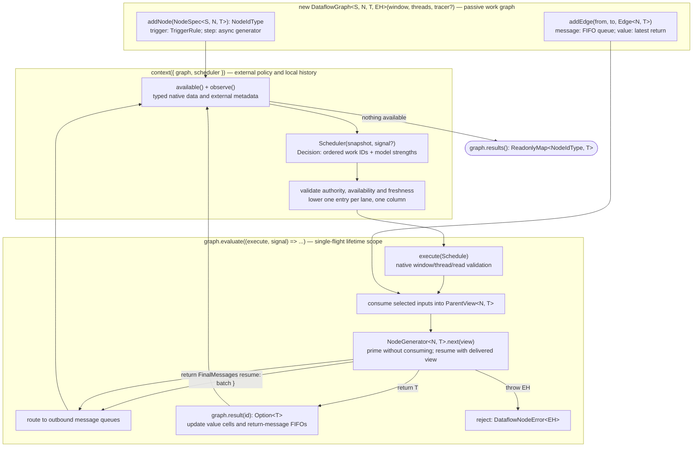

# dataflow-engine

Async-generator dataflow engine for TypeScript with externally paired scheduling policies.

Each node is an `async function*`. The graph owns the nodes and their lifetime. Its triggers admit work, and a generator can request another turn of work already in progress. The external `junco-scheduler` context selects eligible nodes and decides which queued inputs they read.

## Architecture



| Part | Role |
|---|---|
| `DataflowGraph<S, N, T, EH>` | Owns native nodes/edges (an `ngraph.graph` multigraph), observations and concrete execution via `evaluate`. `S` and `T` retain native state and result types; `N extends TSchema` is the TypeBox message schema (payloads are raw `Static<N>`, use a union of schema types for heterogeneous graphs); `EH` is the node-body error type. Construction takes only window/thread bounds and an optional tracer. |
| `Edge.message(id, schema, probe?)`, `Edge.value(…)`, `Edge.returned(…)` | `message` queues ordinary publications. `value` retains the latest successful return; `returned` queues each successful return by reference, even if the same object returns twice. All require TypeBox schemas. A return must pass every destination schema before any result, cell or FIFO changes. An optional `probe(value)` observes each accepted publication after delivery; its exceptions are reported and swallowed. |
| Triggers | Decide **which** inbound edges must have something before a node can run: `always`, `when`, `allOf`, `anyOf`, `never`. |
| `SchedulerContext<S,N,T,C,G>` | Externally pairs a graph with a typed policy, application metadata `C` and independent history; its `step()`/`run()` drive the graph. Policies and contexts are never work members. |

## Install

The package isn't published to npm. It lives in the [junco](https://github.com/microsoft/junco) Bun workspace at `packages/dataflow-engine`. Build it and install the tarball:

```sh
bun install                                                  # once, at the workspace root
(cd packages/dataflow-engine && bun run build && bun pm pack)   # writes dataflow-engine-0.1.0.tgz
cd <your-app> && bun add <junco>/packages/dataflow-engine/dataflow-engine-0.1.0.tgz
```

Under Bun, the `bun` export condition loads `src/index.ts` directly. The `import` condition serves the Bun-built `dist/index.js`, and types come from `dist/index.d.ts`.

## Quick start

```ts
import { context, parallel } from "junco-scheduler";
import {
  DataflowGraph, Edge, EmitOnce, Message, StepNode, TriggerRule, UNBOUNDED, Width, from,
} from "dataflow-engine";
import type { NodeGenerator } from "dataflow-engine";
import { Type } from "typebox";

const NumberSchema = Type.Number();
type Num = typeof NumberSchema;
const numbers = Edge.message<Num, string>("numbers", NumberSchema);
const squares = Edge.message<Num, string>("squares", NumberSchema);
const graph = new DataflowGraph<void, Num, string, never>(
  Width.create(1), UNBOUNDED,
);
const execution = context({ scheduler: parallel(), graph });

const source = graph.addNode(new EmitOnce<void, Num, string>(
  () => [Message.create(numbers, 1), Message.create(numbers, 2), Message.create(numbers, 3)],
  "source done",
  { state: undefined, trigger: TriggerRule.always() },
));

const square = graph.addNode({
  state: undefined,
  trigger: TriggerRule.when(numbers),
  step: async function* (): NodeGenerator<Num, string> {
    let view = yield []; // prime: the first activation delivers no input
    while (true) view = yield from(view, numbers).map((n) => Message.create(squares, n * n));
  },
});

const seen: number[] = [];
const sink = graph.addNode(new StepNode<void, Num, string>((_state, view) => {
  seen.push(...from(view, squares));
  return [];
}, { state: undefined, trigger: TriggerRule.when(squares) }));

graph.addEdge(source, square, numbers).addEdge(square, sink, squares);
const results = await execution.run();
// seen = [1, 4, 9]; results.get(source) = "source done"; square and sink never return.
```

## Writing nodes as async generators

A node body has the type `NodeGenerator<N, T> = AsyncGenerator<NodeYield<N>, T | FinalMessages<N>, ParentView<N, T>>`. Each activation advances its generator exactly once:

1. **Prime.** On a node's first activation (or its first activation after re-arming), the runtime calls `step()` to create a fresh generator and then `next()` without consuming any input. A dependent node therefore starts with `let view = yield []`, while a source can yield real output straight away.
2. **Deliver.** When the trigger fires, the runtime calls `next(view)` with the scheduled messages and resolved inbound values. `from(view, edge)` reads this turn's batch; `view.messages` has a key only for an edge that delivered something. A turn admitted only as a continuation receives empty message and value lookups, even if a non-triggering input is queued.
3. **Yield.** `yield batch` publishes messages in order and waits for the trigger to fire again. `yield { resume: batch }` publishes in the same order and requests another turn of this operation. Either batch may be empty.
4. **Finish.** `return value` records the result (including `undefined`), updates every outbound value cell, and enqueues the return once on each `Edge.returned` FIFO. A value self-edge re-arms the node: the next admission starts a fresh generator with the same state. `return new FinalMessages(batch)` instead publishes the batch and ends the node in this activation, without recording a result, resolving a cell or sending a return notification.
5. **Fail.** A throw terminates the node and rejects execution with `DataflowNodeError` (`nodeId`, `error: EH`) — unless the node has an `on_error` hook (below). A `UsageLimitError` (an exhausted token or tool budget; see `junco-scheduler`'s `limit`), alone or inside an `AggregateError`/`cause` chain, propagates unchanged and never reaches `on_error`. A budget that already failed refuses the activation before it starts, and fails it after its body returns, before anything is routed.

An optional `on_error(error, signal)` (`ErrorFn<S, N, T>`) on the spec recovers a body failure: a throw from `step()` or the generator's `next()`. The node is `done` first; the hook then runs once, as a method with the node as `this`, in the same activation, and its returned messages are routed in order like a yield (`[]` routes nothing). The node records no result and its value edges stay unresolved; the tracer sees the activation's `fail(error)` and, if nothing else fails, a normal run `end`. A body that threw exactly the aborted signal's reason propagates it without calling the hook. Wiring, scheduling and routing errors (`DataflowDefinitionError`) never reach it. A hook that throws rejects the invocation with `DataflowNodeError` carrying its own error (or a `DataflowDefinitionError`/the aborted signal's reason unchanged) and is never run again; an unwired returned message rejects after earlier ones were queued.

A non-arrow body receives its `Node` as `this`, so it can read and write `this.state`.

Local variables in a generator persist across activations, but not across re-armed runs; retain cross-run data in the node's state. Here, taken from `examples/fibonacci.ts`, a node feeds itself through a message self-loop within one generator and stops after ten turns:

```ts
const fib = graph.addNode({
  state: undefined,
  trigger: TriggerRule.anyOf(TriggerEntry.on(seed), TriggerEntry.on(loop)),
  step: async function* (): NodeGenerator<Num, string> {
    let view = yield [];
    for (let i = 0; i < 10; i++) {
      const [a, b] = (view.messages.get(seed.id) ?? view.messages.get(loop.id))!;
      view = yield [Message.create(out, a), Message.create(loop, b), Message.create(loop, a + b)];
    }
    return "emitted 10";
  },
});
graph.addEdge(seedId, fib, seed).addEdge(fib, fib, loop).addEdge(fib, sinkId, out);
```

A value edge passes a node's return value downstream:

```ts
const done = Edge.value("done", Type.String()); // Edge<never, string>
const report = graph.addNode({
  state: undefined,
  trigger: TriggerRule.when(done),
  step: async function* (): NodeGenerator<Num, string> {
    const view = yield [];
    return `source returned: ${view.values.get(done.id)}`;
  },
});
graph.addEdge(source, report, done);
```

A resolved value stays true as a trigger operand and carries the source's latest result. Returning ends an ordinary native node unless it has a value self-edge. That self-edge re-arms the node even if its result did not change; a non-self edge or message self-edge does not. To run once per upstream settlement, consume an `Edge.returned` FIFO. A loop that repeatedly re-arms on `always` or a retained value can keep `run()` active indefinitely.

### Constant fan-out and fan-in

`new ConstFanout(...)` and `new ConstFanin(...)` construct complete specs for `graph.addNode`; wire their edges with `graph.addEdge` as usual. `new ConstFanout(payload, outputs, { state, ret })` sends the same `payload` (by reference) once on every output message edge, then returns `ret`. `new ConstFanin(inputs, output, { state, ret })` waits until every input message edge has delivered, across any number of activations or `run()` calls, then sends one list on `output` in `inputs` order (not arrival order) and returns `ret`; later input never produces another list, and no inputs send one `[]`. Inputs are `Edge<C, T>` and the output is `Edge<TArray<C>, T>`, so the graph's message type must admit both. Construct one `ConstFanin` per collector node. Both throw `DataflowDefinitionError` for a value edge or a repeated edge id.

```ts
import { context, parallel } from "junco-scheduler";
import { ConstFanout, ConstFanin, DataflowGraph, Edge, StepNode, TriggerRule, UNBOUNDED, Width, from } from "dataflow-engine";
import { Type } from "typebox";

const NumberSchema = Type.Number();
const ListSchema = Type.Array(NumberSchema);
const a = Edge.message<typeof NumberSchema, string>("a", NumberSchema);
const b = Edge.message<typeof NumberSchema, string>("b", NumberSchema);
const list = Edge.message<typeof ListSchema, string>("list", ListSchema);
const graph = new DataflowGraph<void, typeof NumberSchema | typeof ListSchema, string, never>(Width.create(1), UNBOUNDED);
const execution = context({ scheduler: parallel(), graph });
const one = graph.addNode(new ConstFanout(1, [a], { state: undefined, ret: "one" }));
const two = graph.addNode(new ConstFanout(2, [b], { state: undefined, ret: "two" }));
const join = graph.addNode(new ConstFanin([b, a], list, { state: undefined, ret: "join" }));
const seen: number[] = [];
const sink = graph.addNode(new StepNode<void, typeof NumberSchema | typeof ListSchema, string>((_state, view) => {
  for (const batch of from(view, list)) {
    if (!Array.isArray(batch)) throw new Error("Expected a collected list");
    seen.push(...batch);
  }
  return [];
}, { state: undefined, trigger: TriggerRule.when(list) }));
graph.addEdge(one, join, a).addEdge(two, join, b).addEdge(join, sink, list); // sink receives [2, 1]
await execution.run(); // seen = [2, 1]
```

## Triggers and schedulers

| Trigger | Fires when |
|---|---|
| `TriggerRule.always()` | every turn (use for sources) |
| `TriggerRule.when(e)` | `e` has a queued message or a resolved value |
| `TriggerRule.allOf(TriggerEntry.on(a), TriggerEntry.on(b))` | every entry is satisfied; when only some are, nothing is read |
| `TriggerRule.anyOf(TriggerEntry.on(a), TriggerEntry.on(b))` | the first satisfied entry, in the order given |
| `TriggerRule.never()` | never (an empty `anyOf`; `always()` is an empty `allOf`) |

`graph.available()` evaluates the declared rule for every unfinished node. It offers the node when the rule fires or the generator owes a continuation. To wait for a larger batch, accumulate inputs in a node body and publish when enough have arrived. To hold work until a release, wire a message edge into its trigger.

`NodeSpec<S, N, T>` is `NodeOptions<N, T>` plus `state`, `step` and the optional `on_error` failure handler. `NodeOptions` contains a required `trigger` and optional `id` and `description`. Descriptions never affect scheduling.

Nodes do not declare resource profiles. To retain measurements for a scheduler, pair it with `context({ graph, scheduler, measurementWindows: new Map([["runtime", 8]]) })`. This keeps the last eight observed runtime samples **per node**. Omitted resources and zero-length windows retain nothing; the default collects nothing.

The sibling package `junco-scheduler` supplies selection operators and resource policies; the engine's `Schedule` is only a concrete execution format.

| Policy | Decision |
|---|---|
| `parallel()` | Selects all available owned work in insertion order, in one linear pass; use unbounded threads when all may run together. |
| `roundRobin(order?, width?)` | Derives a cyclic cursor from context-local projected history; default raw string order is `"1" < "10" < "2"`, default width 1. |
| `choose({ where?, rank, width? })` | Filters available owned IDs, sorts by comparator with raw string-ID ties, and takes the requested width (default 1). |
| `separate(leftOwns, left, right)` | Gives complementary disjoint authority/history to both children, drains both, validates scoped selections and concatenates left then right. |
| `agent(invoke)` | Calls a typed oracle once, then chooses only the first non-empty currently applicable stable-deduplicated wave. |
| `limit({ memory }, scheduler)` | Admits selected nodes in order using their highest retained memory sample or a larger scheduler-supplied `memoryFloor(nodeId)` in bytes. A node with neither runs alone. |
| `lowest(kind)` / `highest(kind)` | Comparators for `choose`, ordering by the most recent sample, measured nodes first; ties use raw string IDs. |

```ts
import { choose, context } from "junco-scheduler";

const execution = context({ graph, scheduler: choose({ rank: () => 0 }) });
const results = await execution.run(); // ties choose by string ID, not registration order
```

`Scheduler<S,N,T,C>` returns `{ selected }`, an ordered array of `{ nodeId, modelStrength, readEdges }` entries. `select(snapshot, ids)` chooses `med` (2) and each node's planned reads. Each selected message edge delivers its whole queue. `nodeIds(selected)` extracts native IDs. `parallel()` and `roundRobin()` work across graph/data domains. The optional `pi` policy is imported from `junco-scheduler/agent`.

`triggerInputs` plans every edge of a satisfied conjunction or the first satisfied edge of a disjunction. A context may customize the plan with `readInputs(id, candidate)`. A continuation-only candidate has an empty plan; a scheduler decision asking to read one of its edges is invalid. At the native `execute` boundary, a read map can take `n`, `"all"` or `"none"` from each edge. Live revalidation ensures a continuation-only turn consumes nothing.

`messageInputs(candidate)` instead reads every nonempty inbound message queue on activation, independent of trigger edges, and consumes no value edges. This keeps inbox delivery opaque while triggers independently control readiness.

Memory admission is not a physical memory cap: an activation may use more than an earlier one, and the engine does not attribute process RSS to individual nodes. Supply a calibrated floor when co-scheduling cold nodes, and leave headroom for memory retained across yields. Token and tool limits are enforced against actual usage, independently of measurement windows.

A `Schedule` is **lanes × turns**: `schedule[lane][turn]`. Turn `w` runs index `w` of every lane concurrently, and the next turn starts only after all of them settle. So `[[A, A], [B]]` runs A and B together, then A alone. A ready node's first occurrence primes its generator and counts as a turn.

The whole window is validated before it starts. Before each turn, the graph takes a fresh availability snapshot and skips any planned node that has since finished or become unavailable. A skipped node is not advanced, reads nothing and is not replaced. For each kept node that is already running, the optional synchronous, pure `resolveInputs(entry, live)` hook recomputes its reads from that snapshot; without the hook, the planned `inputs` are used unchanged, including deliberate partial reads. Every read map in a turn is validated before any node in that turn advances.

### Driving a graph

Construct `const execution = context({ graph, scheduler: parallel() })`; neither graph construction nor pairing calls the policy or starts work.

| Call | Executes |
|---|---|
| `execution.step(options?)` | At most one current decision, lowered to one column. Quiescence returns results without a policy call. |
| `execution.run(options?)` | Repeated current decisions until `graph.available()` is empty. |
| `graph.evaluate((execute, signal) => operation, options?)` | One native evaluation scope around arbitrary planning and serial concrete `execute(schedule, options?)` calls. |

Context drives return cumulative completed-node results, available separately through `graph.results()` or `graph.result(id)`. Quiescence does not imply every node completed. Add nodes/edges or emit inputs and drive again. The graph has no policy `run`/`step` methods or scheduler property. Different contexts may share a graph and have independent histories, but its single-flight evaluation gate rejects overlap before any competing policy runs.

`options.signal` is checked before planning, before each column and after it drains. Original cancellation wins and starts no later column; admitted activations are always awaited. A scope-bound executor rejects concurrent calls and calls after scope exit. Even forgotten/unawaited concrete execution is drained before the evaluation/tracer settles; distinct operation/execution failures aggregate in that order. Successful earlier work is never rolled back. The synchronous non-throwing `onColumn` observer receives actual started IDs in lane order after each non-empty column drains, including a failed column.

For raw observations, pass `onMeasurement: (nodeId, kind, value) => …` to `execute`. A node or its instrumentation can call `recordResourceMeasurement(kind, value)` in its usage context. Values are non-negative integers: memory in bytes, runtime in milliseconds, tokens as counts and cost in micro-USD. Missing samples are not zero. With `measureRuntime: true`, each prime or resume reports elapsed monotonic time rounded to the nearest millisecond, including failed activations. Skipped turns report nothing. Without runtime measurement the executor does not read the clock.

### Typed observations and selection authority

`graph.observe(): DataflowObservation<S,N,T>` captures **all** native nodes, including done/unavailable work, with `id`, `status`, optional `description` and native `state`; insertion-ordered link tuples retain direction, parallel links and self-loops. It also contains detached `ParentView` input containers, retained results and a monotone native version. Neither observation nor availability consumes input or advances a node. Cached containers are reused until a tracked mutation, activation admission or settlement advances that version; direct writes through retained nodes/transports or opaque values are not tracked.

Containers, queue arrays, primitive fields and membership/order are detached. Opaque `S/N/T` identities are borrowed, never deep-cloned or frozen: policies must only read them, and applications needing historical object contents must use immutable data. External `describeNode` metadata is captured freshly per decision, not cached with native observations; omission gives an empty `ReadonlyMap<NodeIdType,never>`, while `0`, `false`, `null` and `""` are valid values. A mutation during planning/read lowering rejects the stale decision before execution, without a retry.

`Snapshot<S,N,T,C>` adds available/owned ID sets, typed external context, local committed `Decision[]` history, the graph's thread bound, and `plans: ReadonlyMap<NodeIdType, InputSchedule>` for the current available nodes. `snapshot.measurements.get(nodeId)?.get(kind)` holds that context's retained samples, oldest first, or is absent if none were recorded. `separate` partitions selection authority over existing work IDs and projects historical selections to each branch, dropping empty events. Native observations, metadata, plans, measurements and threads stay shared. This does not partition memory, effects, queues or external services, nor guarantee capacity, progress or fairness.

### Deterministic source and sink ports

`Source<N,T>(route, { id, schema, trigger?, description? })` and `Sink<N,T>(body, { id, schema, trigger, description? })` are native node specs (`state === this`). They consume scheduling capacity and appear in topology, tracing and history. Plain `DataflowGraph` does not require ports; `JuncoGraph` takes fresh positional instances.

`source.enqueue(view)` validates and detaches a nonempty delivery before appending it to the FIFO. Empty message keys and present value keys (including `undefined`) survive; opaque payloads remain borrowed. `peek()` observes the head without consuming it. A source with no pending delivery is never offered, even if it holds a credit. With the default `always` trigger, each activation routes one delivery. An edge-triggered source first primes without consuming anything. Each subsequent activation must read credits satisfying its trigger before routing the FIFO head. Only ordinary inbound message edges named in the source trigger may carry credits. The source revision advances on enqueue and consumption, never on reads.

A sink stages its body's yielded or terminal messages in its ordered outbox. It forwards the body's choice to wait for another trigger or request a continuation. `sink.send(message)` can also stage output before the body returns a value. `drain(deliver)` removes each message only after delivery succeeds; a failure retains that message and its suffix. Use a consumable input or finish the sink when no further work is expected. A nested agency's result comes from its designated sink, including a returned `undefined`.

### Emitting from outside a node body

`graph.emit(fromId, Message.create(edge, payload))` synchronously appends one validated payload to an ordinary message edge wired out of `fromId`, just like a yielded message. It does not advance a node or resolve a value cell. Calls and yields append in invocation order; a successful publication is never rolled back. An unwired, incoming-only, value or return-message edge throws `DataflowDefinitionError`: only the runtime can publish a settlement. Call `emit` on the graph that owns the outgoing edge.

## Offline profile fitting

Use [`dataflow-profile`](../dataflow-profile) to fit and query models from recorded JSONL samples. Graph construction and execution do not load those models or turn predictions into observations.

## Rendering graph topology

`DataflowGraph` implements the exported structural `Pretty` contract. `renderPretty(graph)` renders the current topology as Mermaid without layout wrapping. Nodes receive synthetic `n0`, `n1`, … identifiers in iteration order and keep their escaped node IDs as labels; every parallel edge is retained and labeled with its escaped edge ID plus `message` or `value`. An empty graph renders as `""`, and each call reads the live topology so later `addNode` and `addEdge` changes appear immediately.

A node whose state is itself a `DataflowGraph` renders as a `subgraph` titled with its node ID, holding that child graph's nodes and edges (recursively, with identifiers unique across the whole document); the containing graph's edges attach to the subgraph boundary. Every occurrence of a shared child graph expands separately. A child graph with no nodes holds one `(empty graph)` marker, and a child graph already on the current containment path holds one `(recursive reference)` marker instead of expanding again; markers are presentation-only and have no edges.

## Tracing

Pass a `DataflowTracer` as the third constructor argument to observe execution; omit it for an untraced graph. `startRun(graph)` fires once per native `evaluate` scope (therefore once per context `step()`/`run()` invocation), covering planning as well as work. Its handle observes every generator activation (`"prime"` without a view, `"resume"` with the delivered view), yield/return, node failure and invocation end/failure. A context step's `end` means that decision completed, not that the graph is quiescent. Callbacks run synchronously as readonly observers and must snapshot retained data before returning. Completion callbacks (`end`/`fail`) may return promises: `evaluate` joins every completion before settling, without awaiting delivery inline. Throws and rejections warn and cannot change computation or mask its failure. There is no tracer `flush()`; a settled `run()` means delivery finished. Complaints are not part of the tracer interface.

A step trace receives the routed batch for both forms of yield. For a terminal batch it receives `done: true` with a `FinalMessages` instance whose `messages` were published; the run's results map contains no result from that completion.

`DummyTracer` is the shipped no-op implementation. The separate [`dataflow-engine-opik`](../dataflow-engine-opik) package provides `OpikTracer(client, name?)`, which exports each run as one Opik trace carrying the graph's Mermaid topology and one child span per activation. This package never depends on Opik.

## Examples and development

`bun run examples` runs six fixed-input graphs, each printing one JSON line: `fibonacci`, `multiplier` (round-robin), `word-count` (`anyOf` fan-in), `combine-per-key` (two reducers), `memory-limit` and `token-race`. The resource examples keep their admission and ranking assumptions in the scheduler rather than in node specs. Run them with `bun run example:memory-limit --no-tracing` and `bun run example:token-race --no-tracing`. The `tests/*.example.ts` files are cookbook graphs.

The memory and token cookbook tests share the side-effect-free `examples/resource-scenarios.ts` runners with the standalone entrypoints. Each invocation creates a fresh graph, returns actual execution observations and borrows an optional caller-owned tracer; evaluation joins its completion promises.

Tests and examples take their schedulers from the workspace's [`junco-scheduler`](../junco-scheduler), a `workspace:*` development dependency (also a dependency of `examples/`; `src/` never imports it). Examples bundle workspace sources and need no build. Typechecks read emitted declarations: after `bun install --frozen-lockfile` at the workspace root, build the engine and scheduler:

```sh
bun run build
(cd ../junco-scheduler && bun run build:core)
```

`build:core` builds only the scheduler's deterministic root, against this engine's emitted declarations, so it needs no agent-side dependencies; CI's `core` job builds it the same way.

The workspace links `dataflow-engine` to this package for every consumer, the scheduler included, so classes such as `DataflowDefinitionError` thrown by the scheduler here are this engine's own; downstream consumers that depend on `dataflow-engine` share one instance.

Every example is traced with Opik by default. The tracer is chosen at **build** time: `examples/run.ts` bundles all standalone and cookbook programs from workspace sources into `examples/dist/{opik,dummy}` and runs nothing unless that bundle succeeds, so a missing source or dependency fails before any example runs. Bundling does not typecheck: `bun run typecheck` checks every example with the Dummy tracer and `bun run examples:typecheck` checks the default Opik route. A traced program constructs the Opik SDK client when it starts, so an invalid Opik configuration fails that program before its graph runs. Append `--no-tracing` to select `DummyTracer`; that build never resolves Opik. There is no runtime fallback.

The Opik build needs the examples workspace's optional dependencies (`dataflow-engine`, `dataflow-engine-opik` and `opik`), which the workspace root install provides; the engine and adapter are bundled from source, so neither needs a build. Configure credentials, workspace and project with `OPIK_API_KEY`, `OPIK_WORKSPACE`, `OPIK_PROJECT_NAME` or `~/.opik.config`. The API defaults to `http://localhost:5173/api`; `OPIK_URL_OVERRIDE` overrides it and takes precedence over a `url_override` in `~/.opik.config`. A successful build does not prove that traces were ingested later.

| Script | Purpose |
|---|---|
| `bun run build` | ESM bundle and source map (Bun), plus declarations (`tsc`) |
| `bun run typecheck` | Checks `src`, `tests` and `examples` with the Dummy tracer selected, including the compile-only `Width` cases |
| `bun run test` / `test:coverage` | Tests and cookbook fixtures with the Dummy tracer; the coverage run writes a text report and `coverage/lcov.info` |
| `bun run examples` / `example:<name>` | Build and run the standalone examples (Opik; add `--no-tracing` for Dummy) |
| `bun run examples:cookbook` | Build and run the cookbook fixtures (Opik; add `--no-tracing` for Dummy) |
| `bun run examples:build` | Bundle only, without typechecking (`--no-tracing` for Dummy) |
| `bun run examples:typecheck` | Checks the examples with the default Opik tracer selected, against the engine, scheduler-core and Opik adapter declarations |
| `bun run check` / `format` | Biome lint and format |

### Running Fibonacci with Opik

Prerequisites: Bun, Docker with Compose, and the junco workspace, which holds this package beside [`dataflow-engine-opik`](../dataflow-engine-opik). Run the commands from the workspace root:

1. Install the workspace, which includes the examples' optional dependencies (`dataflow-engine`, `dataflow-engine-opik` and `opik`); the example bundles the engine and the Opik integration from source, so no package build comes first:

   ```sh
   bun install --frozen-lockfile
   ```

2. Start the workspace's root telemetry deployment (see the [Junco setup](../../README.md#telemetry-deployment)); Opik UI/API is on port 5173:

   ```sh
   docker compose -f docker-compose.yml up -d --no-build
   ```

3. Run the example:

   ```sh
   cd packages/dataflow-engine
   OPIK_PROJECT_NAME=dataflow-engine bun run example:fibonacci
   ```

   It prints `[0,1,1,2,3,5,8,13,21,34]`. Without `OPIK_PROJECT_NAME` the trace goes to Opik's "Default Project".

4. Open <http://localhost:5173>, choose project **dataflow-engine** → **Logs** → **Traces**, and open the `examples/fibonacci` row. The **Agent graph** panel below the span list shows nodes `0`, `1` and `2`, the `fibSeed` and `fibOut` edges and the `fibLoop` self-loop; each `1 #n` span holds one activation's delivered input and emitted output.

5. On a disposable development deployment, stop the stack with `docker compose -f docker-compose.yml stop` from the workspace root. Leave shared services running.

## License

[MIT](LICENSE)
